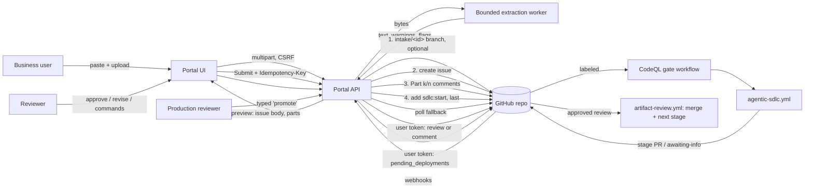
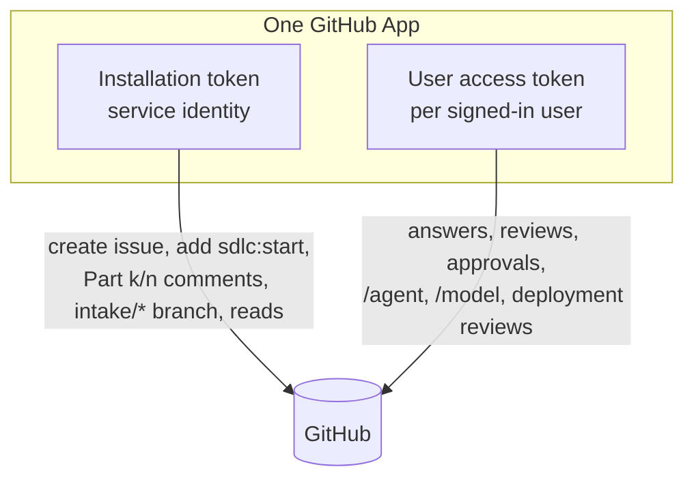

# AISDLC Portal: architecture

The portal is the front door and review desk for the existing AISDLC pipeline. It does not re-implement
AISDLC. It creates a well-formed requirement issue, then lets the right people answer questions, review
stage pull requests and approve production releases, always with their own GitHub identity.

## Components

| Component | Technology | Location |
|---|---|---|
| Web UI | React 18 + TypeScript, Vite | `frontend/src` |
| API | FastAPI (Python 3.12), sync handlers in a thread pool | `backend/app` |
| Extraction worker | Spawned child process per file, timeout and memory cap | `backend/app/extract` |
| Database | SQLAlchemy: SQLite (dev), PostgreSQL / Azure SQL (deploy) | `backend/app/db.py` |
| GitHub access | One GitHub App, two clients that are never mixed | `backend/app/github` |
| Status tracking | Webhook receiver plus polling fallback | `backend/app/status` |
| Fake GitHub | In-memory GitHub + AISDLC simulation (dev and tests only) | `backend/app/github/fake.py` |

## Data flow



Service identity arrows (1-4 and reads) use the GitHub App installation token. Reviewer, answer and
production arrows use the signed-in user's own GitHub App user access token.

## How AISDLC reads context, and what that means for the portal

From `.github/workflows/agentic-sdlc.yml` ("Fetch requirement context"):

```
gh issue view N --json title,body,comments
  -> TITLE + BODY + comments where author.login is not github-actions / github-actions[bot]
     and body does not start with "/model " or "/agent "
```

- Only the issue title, body and comments reach the agents. Links are never followed, so any text that
  must influence generation has to be in the body or a comment.
- Any login other than `github-actions[bot]` counts as human, including other bots and the portal's
  GitHub App. That is why answers, reviews and commands must use the user's own token.
- The readiness gate (`config/readiness.yml`) is case-insensitive substring matching over that whole
  context. Words like *request*, *require*, *objective*, *stakeholder*, *user*, *team* and *access*
  satisfy it. The portal's boilerplate avoids all of them, and headings for empty fields are omitted.
  Otherwise the gate would always pass and never ask for missing information. `tests/test_issue_builder.py`
  checks this against the real `config/readiness.yml`. As a result the spec's "Request ID" heading
  appears as "Portal reference ID", and "Pasted requirement text" as "Pasted text".
- The CodeQL gate removes `sdlc:start` when it dispatches, so the portal does not rely on that label for
  status.
- A human comment resumes a paused run only if the issue has `sdlc:awaiting-info`, CodeQL is green on the
  current `main` commit, and a saved state artifact exists. Answers starting with `/` are ignored, so the
  portal refuses them.

## Overflow decision (65,536-character issue limit)

**Chosen: a hybrid.** Text overflows into comments. The full text and the original files also go to a
non-main branch.

1. The issue body holds the structured sections plus as much of each document as fits (about 60,000
   characters). Small documents fit whole; large ones share the rest.
2. The remainder is split at paragraph boundaries into `[Part k/n of <file>]` comments (60,000 characters
   max each), posted before `sdlc:start`.
3. When there is overflow, or originals to keep, the full extracted Markdown and the original files are
   committed to `intake/<request-id>` and linked from the body. This uses the Git Data API, never `main`,
   so CodeQL does not restart and no intake issue is created. No workflow in the repo triggers on pushes
   to non-main branches.
4. There is a ceiling on text visible to AISDLC (`MAX_ISSUE_VISIBLE_CHARS`, 900,000 by default). Text
   beyond it stays only on the branch and the body says so. If the branch is unavailable (disabled, or a
   public repository), submission is refused rather than losing content.

Why not branch-only: the orchestrator never reads links, so text kept only on a branch is invisible to
generation. Why not comments-only: original binaries cannot go in comments, and traceability needs the
exact uploaded files. Branch uploads are refused on public repositories unless
`ALLOW_PUBLIC_REPO_UPLOADS=true`.

## Two-token model



| | Service (installation token) | User (user access token) |
|---|---|---|
| Client class | `ServiceGitHubClient` | `UserGitHubClient` |
| Allowed writes | `POST issues` (no labels), `POST labels` with exactly `["sdlc:start"]`, `POST comments` only matching `^\[Part \d+/\d+ of `, Git Data writes, refs only under `refs/heads/intake/` | `POST issues/N/comments`, `POST pulls/N/reviews`, `POST actions/runs/N/pending_deployments` |
| Never | reviews, approvals, merges, `/agent`, `/model`, answers, deployment reviews | labels, merges, contents, issue creation |
| Enforcement | Deny-by-default request guard (`IdentityViolation`). The token is requested with `pull_requests: read`, so GitHub refuses reviews too. | Deny-by-default request guard. GitHub applies the user's own permissions, branch protection and CODEOWNERS. |
| Tests | `tests/test_github_clients.py` (guard, method absence, AST scan), `tests/test_api_review.py::assert_bot_only_posted_parts` | as left |

Retries (rate limits) never switch identity. Writes are retried only when GitHub rejected them before
acting (429 or rate-limit 403), never on 5xx, so a comment or review is never posted twice.

## Identity mapping

- Portal sign-in is Entra ID (OIDC code flow with PKCE, ID token validated server-side: signature, issuer,
  audience, tenant, nonce, expiry). Roles come from Entra app roles (`Requester`, `Reviewer`).
- "Connect GitHub" runs the GitHub App user OAuth web flow with a signed `state` bound to the portal
  session. The callback calls `GET /user` and stores the **numeric GitHub id** and login. Both the Entra
  user and the GitHub id are unique in `github_links`: one Entra user maps to exactly one GitHub account.
- Tokens are encrypted with Fernet (keys from `TOKEN_ENCRYPTION_KEY`, rotation supported) and refreshed
  shortly before expiry. A failed refresh or a 401 marks the link revoked and the UI asks the user to
  reconnect.
- Before approvals (stage and production), the portal re-checks `GET /user` and requires the id to match
  the stored one.

### Optional GitHub sign-in

With `GITHUB_SIGNIN_ENABLED=true`, people without a work account sign in through the same GitHub App OAuth
flow. The portal identity is then the numeric GitHub id (`github:<id>`). The repository role decides access:
`GITHUB_SIGNIN_MIN_ROLE` (default triage) to get in, Requester for everyone, and Reviewer for write or more.
A GitHub account linked to an Entra user can never open that Entra account. Off by default.

## Approval pre-check

For each stage PR and user, the portal checks (`app/review/precheck.py`):

- the PR is open, not a draft, and is this request's `sdlc/issue-<n>/<stage>` PR;
- the user has write, maintain or admin access;
- the user is not the PR author;
- the user is a CODEOWNER of at least one changed file (from the base branch; team membership via the
  org API). `CODEOWNERS_POLICY=strict` blocks otherwise, `advisory` warns;
- branch protection and rulesets are read and summarised (unknown if the App cannot read them);
- optional separation of duties: the requester cannot approve their own BRD/PRD;
- the user has not already approved this head commit.

Approve is shown only when every check passes. The server runs the same check again on submit. The UI
pins the head SHA the reviewer saw, and a changed PR is rejected with `pr_changed`. GitHub's answer is
final: rejections are relayed verbatim and never retried with another identity.

## Threat model (summary)

| Threat | Mitigation |
|---|---|
| Portal used to forge "human" approvals or answers | Service client cannot comment freely, review or approve (guard + down-scoped token + tests). All human actions use the user's own token and are audited. |
| Approval by someone who should not approve | Pre-check plus GitHub branch protection and CODEOWNERS. **Required GitHub configuration is listed in the README;** without it GitHub does not enforce reviewers, and `artifact-review.yml` advances on any approval. |
| Prompt injection via documents | Content is wrapped in labelled untrusted fences that the content cannot break (fence longer than any tilde run). Likely injection phrases are flagged to the user without altering text. AISDLC already treats issue text as data. |
| Command injection through `/agent` / `/model` text | `feedback-handler.yml` passes comment text only through `env:`, parses the first line, writes only validated outputs, and requires write access (tested in `tests/test_feedback_workflow.py`). The portal also allowlists commands and, while `BLOCK_SHELL_METACHARACTERS=true`, refuses `" $ \` and backtick, and lines starting with `/`. |
| Malicious files (macros, scripts, bombs, parser exploits) | Extension + magic-byte allowlist. Legacy and macro formats rejected. Zip entry, size and ratio caps. Page, slide and cell caps. Spawned worker with timeout and address-space limit. Malware-scan hook (fail closed). Nothing embedded is executed. |
| Token theft | Tokens are server-side only, encrypted at rest, never in responses, logs or the bundle (tested). Log redaction for token patterns, JWTs, OAuth codes and keys. |
| CSRF / XSS / clickjacking | SameSite=Lax HttpOnly cookie plus a per-session CSRF header. Strict CSP (`script-src 'self'`). Markdown rendered without raw HTML. Mermaid in strict mode. `frame-ancestors 'none'`. |
| Accessing others' requests | Server-side authorisation on every request: requester, or assigned reviewer (code owner, team, requested or default reviewer). Probing returns 404. |
| Duplicate issues | Per-user idempotency key (unique constraint), a content-hash window, an atomic submit claim, and marker search on retry. |
| Dev shortcuts in production | `AUTH_MODE=dev` and `GITHUB_MODE=fake` raise at startup unless `APP_ENV` is development/test (dev auth also requires loopback). Dev routes are not registered otherwise. |
| Webhook spoofing / replay | HMAC-SHA256 with a constant-time compare, required secret, delivery-id dedupe, 5 MB cap. |
| Abuse | Per-user rate limits, request body cap (including chunked uploads), file count and size caps. |

## Data model

`users`, `github_links` (encrypted tokens), `drafts` (encrypted preview payload, TTL), `requests`
(metadata, submit step, status snapshot), `assignments`, `audit_log`, `webhook_deliveries`. Document
contents are kept only while a draft or submission is in flight: the encrypted draft and pending plan are
deleted on success or TTL. `RETAIN_EXTRACTED_TEXT_DAYS=0` by default.

## Status mapping

| Portal status | Derived from |
|---|---|
| `submit_failed` | A GitHub step failed during submit (resumable) |
| `queued` | `sdlc:start` still present, or the gate's "SDLC is queued" comment (CodeQL not green) |
| `running` | Latest `Agentic SDLC issue #N` run queued or in progress |
| `awaiting_info` | `sdlc:awaiting-info` label. Questions are parsed from the latest "Generation blocked" bot comment. |
| `awaiting_model` | A "AI Model Recommendation" bot comment newer than the last "Model decision recorded" |
| `in_review` | An open `sdlc/issue-N/*` PR (QC and model parsed from its "AI Generation Summary") |
| `needs_attention` | The latest "paused — QC" comment |
| `complete` | "Agentic generation stages complete" comment |
