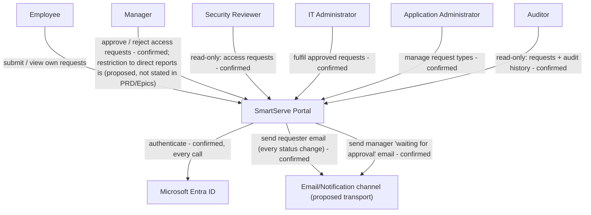
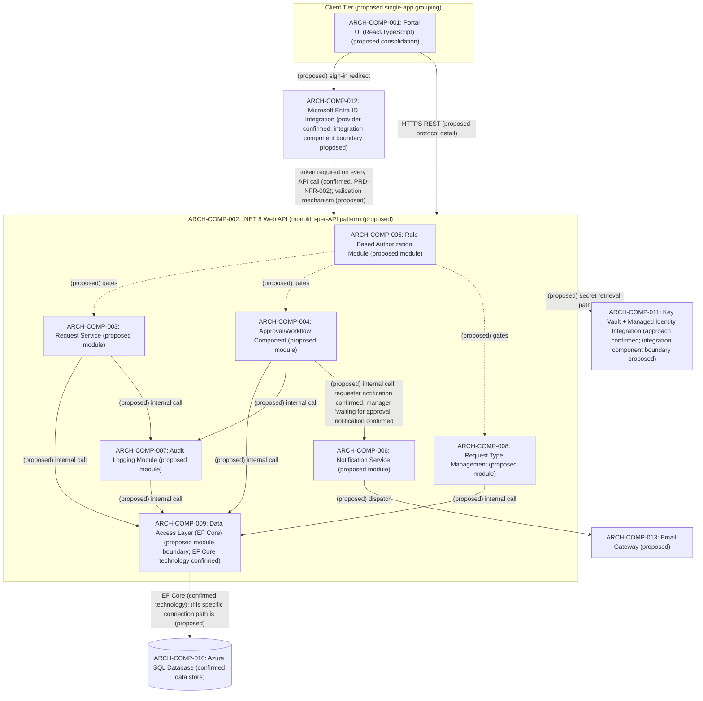
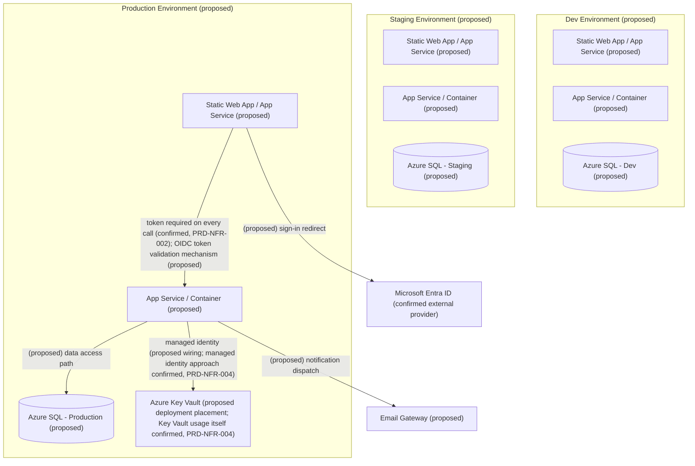
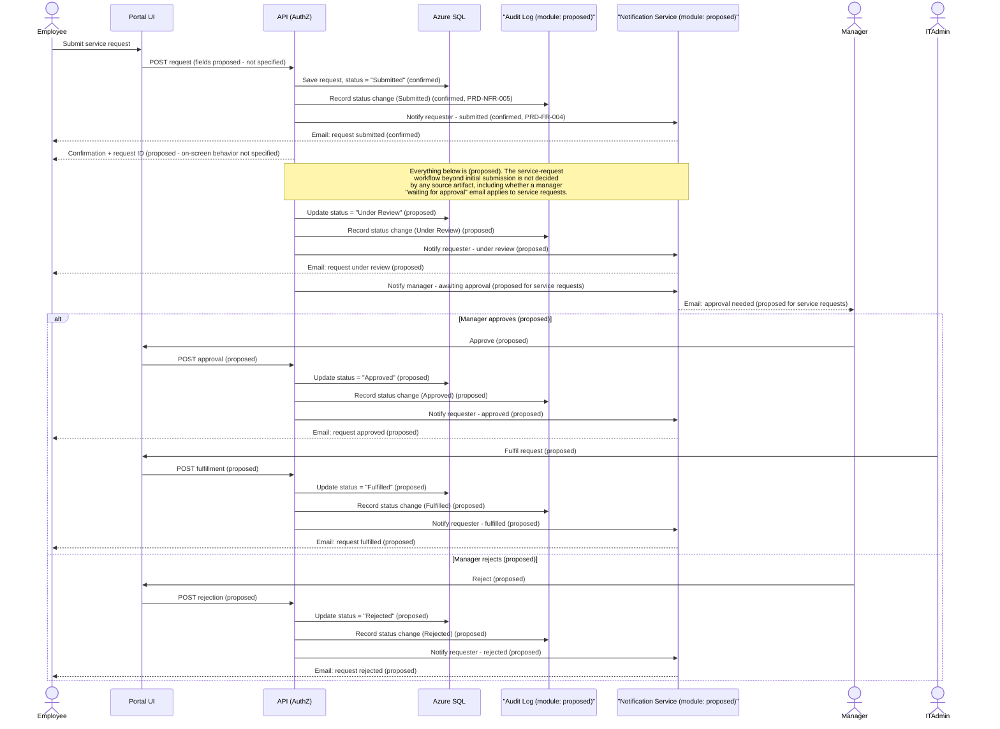
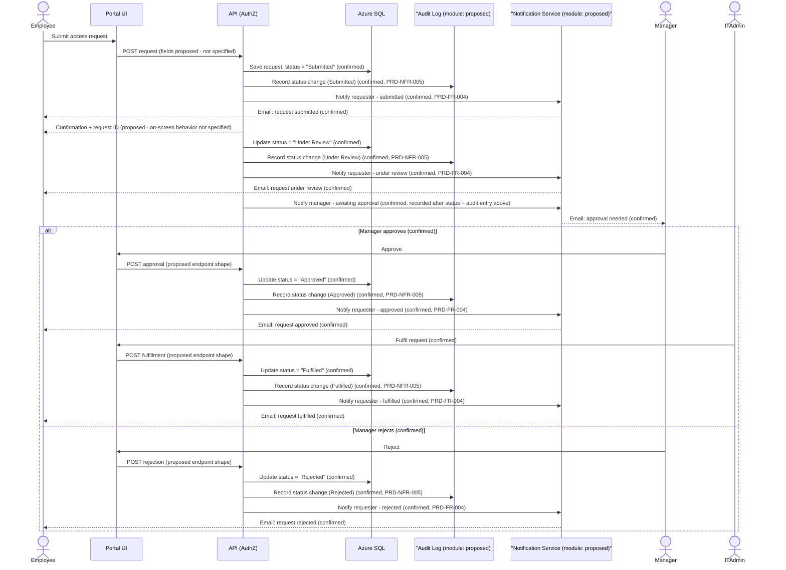

# SmartServe - Architecture Plan

## Executive Summary

This document defines the proposed technical architecture for the SmartServe IT service and access request portal, derived from PRD-23 and the confirmed Epic-level and architecture-level decisions supplied by stakeholders, including the latest authoritative decisions and clarifications for issue #23. Confirmed business decisions — the access-request status sequence (Submitted → Under Review → Approved/Rejected → Fulfilled), manager approval or rejection with IT administrator fulfillment on approval, a requester email on every status change, a manager email when a request moves to Under Review (sent after the status and its audit entry are recorded), mandatory Microsoft Entra ID authentication on every API endpoint (no anonymous endpoints), server-side role-based authorization, and an audit record at every status change — are implemented as stated. Audit retention period, whether manager approval is restricted to an approver's direct reports, the IT service-request (non-access) workflow beyond initial submission, and submission form fields / on-screen confirmation behavior are **not** confirmed by any source artifact and are recorded here as **(proposed)** or as open questions. Confirmed workflow behavior (statuses, approvals, rejection, fulfillment, notifications, audit logging, and request-type management) is distinct from its mapping onto specific components, endpoints, or role-to-endpoint permissions: the behavior itself is confirmed, while the component decomposition, connections, deployment choices, and endpoint/permission mappings that implement it are **(proposed)** unless a source artifact states otherwise, and each such item is labeled at its point of use in this document.

## System Context



**Overview:** SmartServe sits between six confirmed stakeholder roles (Employee, Manager, Security Reviewer, IT Administrator, Application Administrator, Auditor — PRD-FR-003) and two external systems: Microsoft Entra ID for authentication (PRD-NFR-001, PRD-NFR-002) and an outbound email channel for notifications (PRD-FR-004).

**Design Decisions / NFR Considerations:** Entra ID centralizes authentication, and the API validates a token on every call with no anonymous endpoints (confirmed, PRD-NFR-002). Per the authoritative access-request workflow, Security Reviewers have read-only visibility of access requests only; they do not approve or reject — manager approval (or rejection) followed by IT admin fulfillment on approval is the confirmed access-request path. Requester notification on every status change is confirmed (PRD-FR-004), and the manager email when a request enters Under Review is likewise confirmed (per authoritative clarification), sent only after the Under Review status and its audit entry are recorded. Whether manager approval authority is limited to the requester's own direct reports is **(proposed)**: no source artifact — not the BRD, PRD, Epics, or the authoritative decisions — establishes this restriction, so it is treated as an open question pending confirmation. The specific email transport is not stated in any source artifact, so it is marked (proposed). Role boundaries shown here drive the API authorization model described in Security.

## Architecture Overview

SmartServe is proposed as a single consolidated portal application **(proposed decomposition)** — one React/TypeScript single-page frontend backed by one .NET 8 Web API following a monolith-per-API pattern **(proposed)**. No source artifact specifies microservices, multiple deployable units, or a different decomposition, so this consolidated approach is the architect's proposed simplification pending validation.

## Component Diagram



### Component Index

- **ARCH-COMP-001 — Portal UI (React/TypeScript):** (proposed consolidation into one app) Hosts employee submission, status viewing, approver, admin, and auditor views. Traces to PRD-FR-001, PRD-FR-002, PRD-FR-003.
- **ARCH-COMP-002 — .NET 8 Web API:** (proposed monolith-per-API pattern) Single backend enforcing authentication and authorization server-side on every call per PRD-NFR-002.
- **ARCH-COMP-003 — Request Service:** (proposed internal module boundary) Handles request creation and status retrieval. Traces to PRD-FR-001, PRD-FR-002.
- **ARCH-COMP-004 — Approval/Workflow Component:** (proposed internal module boundary) Implements the confirmed access-request approval/rejection/fulfillment steps and status transitions; the service-request workflow beyond initial submission is undecided (open question). Traces to PRD-FR-002.
- **ARCH-COMP-005 — Role-Based Authorization Module:** (proposed internal module boundary) The capability — server-side role enforcement and token validation on every API call, no anonymous endpoints — is confirmed (PRD-NFR-002); its decomposition as a distinct module, and its mapping onto specific endpoints/permissions, is a proposed implementation choice, since no source artifact specifies internal module boundaries.
- **ARCH-COMP-006 — Notification Service:** (proposed internal module boundary) The capability — emailing the requester on every status change, and emailing the manager when a request moves to Under Review and is waiting for their approval — is confirmed (PRD-FR-004; manager email confirmed per authoritative clarification). Its decomposition as a distinct module is **(proposed)**.
- **ARCH-COMP-007 — Audit Logging Module:** (proposed internal module boundary) The capability — recording actor/timestamp/old-status/new-status at every status change — is confirmed (PRD-NFR-005). The **audit retention period is not confirmed and remains an open question**; its decomposition as a distinct module is proposed.
- **ARCH-COMP-008 — Request Type Management:** (proposed internal module boundary) The capability itself — application administrators create, edit, and deactivate request types — is confirmed by authoritative issue comment. Traces to PRD-FR-001 (request types) and PRD-FR-003 (role permissions), confirmed in issue comment; its decomposition as a distinct module is a proposed implementation choice.
- **ARCH-COMP-009 — Data Access Layer (EF Core):** EF Core is the confirmed persistence technology (PRD-NFR-003); its decomposition as a distinct internal module/layer is **(proposed)**.
- **ARCH-COMP-010 — Azure SQL Database:** Confirmed data store. Traces to PRD-NFR-003.
- **ARCH-COMP-011 — Key Vault + Managed Identity Integration:** Confirmed secret-management approach; the integration component boundary shown and the specific secrets stored (e.g., connection strings vs. API keys) are **(proposed / open question)**, not enumerated in any source artifact. Traces to PRD-NFR-004.
- **ARCH-COMP-012 — Microsoft Entra ID Integration:** Confirmed authentication provider, required on every API call, with no anonymous endpoints. The integration component boundary shown is **(proposed)**. Traces to PRD-NFR-001, PRD-NFR-002.
- **ARCH-COMP-013 — Email Gateway:** (proposed) Specific email transport/provider is not specified in any source artifact. Traces to PRD-FR-004.

**Relationships:** All client traffic flows through the API; the API is the sole authentication and authorization enforcement point, with no anonymous endpoints (confirmed, PRD-NFR-002). Internal module boundaries (ARCH-COMP-003, -004, -005, -006, -007, -008, -009) and every connection among them shown above are a **(proposed)** logical decomposition inside the single API, not separately deployable services or confirmed call paths, since no artifact specifies internal service boundaries or wiring. The confirmed capabilities themselves are: access-request handling with the stated status sequence and manager approval/rejection/fulfillment, requester notification on every status change, manager notification when a request enters Under Review, audit logging at every status change (retention period open), request type management, EF Core persistence, Key Vault/managed identity secret handling, and Entra ID authentication with server-side role authorization on every call. These capabilities are confirmed; only their decomposition into the specific modules/connections drawn above, and their eventual mapping onto specific API endpoints and role-to-endpoint permissions, are **(proposed)**. Whether manager approval is restricted to direct reports, and the detailed service-request workflow, remain open questions.

**Trade-offs:** A consolidated monolith is simpler to secure and deploy but limits independent scaling of workflow vs. request-submission load; this trade-off is proposed, not confirmed, and should be revisited if load profiles diverge.

**Risks and Mitigations:** Risk — internal module boundaries and connections may not match eventual implementation; mitigate by treating all (proposed)-labeled components and edges as logical, not contractual, until a technical design doc confirms them.

## Deployment Diagram



**Overview:** Shows candidate Dev/Staging/Production environments for the consolidated portal. No source artifact confirms environment names, counts, hosting services (App Service vs. Container Apps vs. Static Web Apps), or network topology, so every environment and hosting choice is labeled **(proposed)**, including Production — no environment, including Production, is treated as confirmed.

**Key Components:** Key Vault access via managed identity is confirmed in principle (PRD-NFR-004), but the specific hosting compute (App Service/Container), the managed-identity wiring shown, and the OIDC token-validation implementation mechanism are all **(proposed)**, matching the Security section. The requirement that a token is validated on every call is confirmed (PRD-NFR-002) and is consistent with the Security and API sections.

**NFR Considerations:**
- **Security:** Managed identity removes stored credentials for Key Vault access in principle (confirmed, PRD-NFR-004); the specific deployment wiring shown is (proposed). The requirement for token validation on every call is confirmed; the OIDC token-validation mechanism (middleware, custom handler, or another approach) is **(proposed)**, matching Security and the API section. Network boundaries and firewall rules between tiers are (proposed) and unconfirmed.
- **Reliability:** Multi-environment promotion (Dev → Staging → Prod) is a (proposed) practice, not stated in any source.
- **Scalability:** Specific scaling tiers/SKUs are not specified; left as (proposed) placeholders.

**Trade-offs:** Naming three environments assumes a standard promotion pipeline; actual environment count/names are unconfirmed and may differ.

**Risks and Mitigations:** Risk — proposed hosting choices may not match actual Azure subscription constraints; mitigate by confirming with infrastructure team before provisioning.

## Data Flow

```mermaid
flowchart LR
    Employee -->|"HTTPS (proposed transport detail)"| UI["Portal UI (proposed consolidation)"]
    Auditor -->|"HTTPS (proposed transport detail)"| UI
    Manager -->|"HTTPS (proposed transport detail)"| UI
    SecurityReviewer -->|"HTTPS (proposed transport detail)"| UI
    ITAdmin -->|"HTTPS (proposed transport detail)"| UI
    AppAdmin -->|"HTTPS (proposed transport detail)"| UI

    UI -->|"authenticated REST calls (proposed session detail)"| API[".NET 8 Web API (proposed decomposition)"]
    API -->|"validate token on every request - confirmed, no anonymous endpoints (PRD-NFR-002); validation mechanism (proposed)"| EntraID["Microsoft Entra ID (confirmed provider)"]
    API -->|role check, server-side (confirmed, PRD-NFR-002)| AuthZ["Role-Based Authorization (proposed module)"]
    AuthZ -->|"allowed (proposed gating logic)"| DataOps["Request / Approval / Admin operations (proposed grouping)"]
    DataOps -->|"EF Core (confirmed technology); grouping/connection (proposed)"| SQL[("Azure SQL Database (confirmed data store)")]
    DataOps -->|"write status-change record (proposed wiring; audit behavior confirmed, PRD-NFR-005)"| AuditLog[("Audit Log table (proposed schema; retention period: open question)")]
    DataOps -->|"trigger (proposed wiring)"| Notify["Notification Service (proposed module)"]
    Notify -->|"email - confirmed, every status change (PRD-FR-004)"| Requester["Requester inbox (proposed node grouping)"]
    Notify -->|"email - 'waiting for approval' notice, confirmed"| Approver["Manager inbox (proposed node grouping)"]
    API -->|"secret retrieval, managed identity (proposed wiring; managed identity approach confirmed, PRD-NFR-004)"| KeyVault["Azure Key Vault (confirmed secret store)"]
```

**Overview:** All users — including Employees and Auditors — reach data exclusively through the Portal UI and the API; no role accesses Azure SQL directly. The API is the single enforcement and access point for the database (PRD-NFR-002, PRD-NFR-003).

**Key Components:** Role-Based Authorization gates every data operation; the Audit Log table (proposed schema) receives a write at each status change, with retention period left as an open question (PRD-NFR-005); Notification Service dispatches confirmed requester emails on every status change, plus a confirmed manager "waiting for approval" email when a request enters Under Review.

**Design Decisions:** Direct user-to-database access is explicitly excluded, since role enforcement must occur server-side per PRD-NFR-002. The internal grouping of "Request / Approval / Admin operations" and the trigger wiring into Notification Service are **(proposed)** logical groupings, not confirmed internal architecture. That the API validates the caller's Entra ID token on every request, with no anonymous endpoints, is confirmed (PRD-NFR-002); the specific validation mechanism/implementation (library, middleware, caching of signing keys, etc.) is **(proposed)**, matching the wording used in the Security and API sections — the behavior is confirmed, the implementation detail is not.

**NFR Considerations:**
- **Security:** No bypass path to Azure SQL exists outside the API (confirmed constraint). Secrets for SQL/Key Vault access use managed identity in principle (confirmed, PRD-NFR-004); the specific secret types (e.g., connection strings vs. API keys) are **(proposed / open question)**, not enumerated in any source artifact.
- **Reliability:** Audit writes occurring alongside business writes should ideally be transactional; this guarantee is **(proposed)** and not stated in any source.
- **Maintainability:** Centralizing data access through EF Core (confirmed, PRD-NFR-003) simplifies schema evolution. Audit retention is **not confirmed by any source artifact** and remains an open question; the retention period and the purge mechanism implementing it are both **(proposed / open question)**.

**Risks and Mitigations:** Risk — if audit writes and status writes aren't atomic, an audit gap could occur; mitigate via a single transaction scope **(proposed)** pending confirmation.

## Key Workflows

### Service Request Workflow (confirmed scope: submission only; remainder proposed)



**Overview:** Only the submission step is confirmed for service (non-access) requests: employee submits, status becomes "Submitted" with a corresponding audit entry, and the requester is emailed (PRD-FR-004, PRD-NFR-005). Every subsequent status, approver, notification (including any manager "waiting for approval" email), and fulfillment step shown is **(proposed)** — modeled by analogy to the access-request workflow for illustrative purposes only, and not confirmed by any source artifact. **Open question:** what status transitions, approvers, and notification rules apply to service requests beyond initial submission?

**NFR Considerations:** Security — any future manager-approval rule for service requests would require defining whether approval is restricted to direct reports, which is **(proposed)**/open question even for access requests (see below). Reliability — notification delivery guarantees beyond the confirmed "submitted" email are (proposed) and unconfirmed for service requests.

### Access Request Workflow (manager approval or rejection → IT admin fulfillment on approval)



**Design Decisions:** This workflow follows the authoritative confirmed architecture decision: Submitted → Under Review → manager Approves or Rejects → if Approved, an IT administrator fulfils it → Fulfilled, with manager rejection ending the workflow as "Rejected." Security Reviewers have read-only visibility of access requests and do not approve or reject, so no security-reviewer approval step is represented (reflected in System Context as well). Audit entries are written at every status change, not only at the end (confirmed, PRD-NFR-005); the **audit retention period is not confirmed and remains an open question**. The requester receives an email on every status change — Submitted, Under Review, Approved/Rejected, Fulfilled — and email is the only confirmed channel (confirmed, PRD-FR-004). The manager email notifying them that a request is awaiting approval is **confirmed** per the authoritative clarification, and is recorded only after the Under Review status and its audit entry are written. Whether manager approval authority is restricted to the requester's own direct reports is **(proposed)** and recorded as an open question: no source artifact — including PRD-FR-003 — establishes this restriction; PRD-FR-003 only states that role permissions (including any manager-to-report scoping) remain to be defined. This workflow behavior (statuses, approvers, rejection, fulfillment, notifications, audit) is confirmed; the specific endpoint shapes shown (`POST approval`, `POST rejection`, `POST fulfillment`) are **(proposed)**.

**NFR Considerations:** Security — whether the authorization module must verify that the acting manager is the requester's direct manager is an **open question / (proposed)** rule, not confirmed by PRD-FR-003 or any other source artifact; any matching mechanism implementing such a rule, if confirmed later, would also be (proposed) at the implementation level. Reliability — notification delivery failure handling is **(proposed)**, not specified in any source.

**Trade-offs:** Showing a single alt/else block for approve-vs-reject keeps the diagram simple but does not depict re-submission or escalation paths, which no source artifact defines.

**Risks and Mitigations:** Risk — if a future decision reintroduces an approval role for security reviewers on access requests, this diagram would need revision; mitigate by confirming the workflow scope with stakeholders before implementation and treating the current manager-approval-only path (with IT admin fulfillment) as authoritative until changed. Risk — building direct-report scoping into the authorization logic before it is confirmed could over- or under-restrict approvals; mitigate by confirming the direct-report restriction with stakeholders before implementation.

## Security

- **Authentication:** Microsoft Entra ID is the confirmed identity provider (PRD-NFR-001). Every API endpoint requires a valid Microsoft Entra ID token; there are no anonymous endpoints (confirmed). This applies uniformly across all routes — no route is exempt from authentication.
- **Authorization:** Enforced server-side in the API via the Role-Based Authorization module (ARCH-COMP-005, proposed module boundary), never relying solely on UI hiding of controls (confirmed, PRD-NFR-002). The capability — server-side, role-based enforcement on every call — is confirmed; its mapping onto specific endpoints and role-to-endpoint permissions is **(proposed)**, as detailed in the API section. Whether manager approval authority is scoped to direct reports is **(proposed)/open question**, not confirmed by PRD-FR-003 or any other source artifact.
- **Token validation:** The .NET 8 API validates the caller's Entra ID token on every request, with no anonymous endpoints — this behavior is **confirmed** (PRD-NFR-002). The specific OIDC token-validation mechanism/implementation (library, middleware, signing-key caching strategy, etc.) is **(proposed)**, matching the label used in the Deployment, Data Flow, and API sections: the "what" is confirmed, the "how" is proposed.
- **Secret management:** Managed Identity and Azure Key Vault are confirmed for secret management, and secrets must not be stored in source control (confirmed, PRD-NFR-004). The specific secret types involved (e.g., connection strings, API keys, certificates) are **(proposed / open question)**, not enumerated in any source artifact.
- **Data access boundary:** Only the API accesses Azure SQL; no role, including Auditor or Employee, connects to the database directly (confirmed via Data Flow requirement).
- **Audit trail as a security control:** Every status change is logged with who/what/when/old-new status (confirmed, PRD-NFR-005). The **audit retention period is not confirmed by any source artifact** and is recorded as an open question, supporting traceability for security reviews once decided.
- **Transport security:** HTTPS/TLS between UI and API is **(proposed)** as a standard practice; not explicitly stated in any source artifact.
- **Network segmentation (e.g., private endpoints, VNET integration):** **(proposed)**, not specified in any source artifact.

**NFR Considerations:** Security requirements here directly satisfy PRD-NFR-001, PRD-NFR-002, and PRD-NFR-004. Items marked (proposed) are architect recommendations pending confirmation, including the OIDC token-validation implementation mechanism, specific secret types, and the direct-report approval-scoping rule; the audit retention period is an open question for business stakeholders, not an architect recommendation.

**Risks and Mitigations:** Risk — without a confirmed token-validation implementation mechanism, inconsistent enforcement could occur across environments; mitigate by finalizing a token-validation implementation standard before Production deployment. Risk — without a confirmed audit retention period, storage sizing and compliance posture are undetermined; mitigate by escalating retention as an open question to business stakeholders. Risk — without confirming the direct-report scoping rule, manager approval authority could be implemented too broadly or too narrowly; mitigate by confirming this rule before implementation.

## API

Workflow behavior — statuses, approvals, rejection, fulfillment, notifications, audit logging, and request-type management — is **confirmed** as described above. Only its mapping onto the specific endpoints, HTTP verbs, and role-to-endpoint permissions below is **(proposed)**, except for the two permission cells explicitly marked confirmed.

| Endpoint (proposed) | Method (proposed) | Employee | Manager | Security Reviewer | IT Admin | App Admin | Auditor | Traces to |
|---|---|---|---|---|---|---|---|---|
| /api/requests (own) | GET | **Confirmed:** allowed (own requests only) | (proposed) not permitted | (proposed) not permitted | (proposed) not permitted | (proposed) not permitted | n/a — superseded by all-requests row | PRD-FR-002, PRD-FR-003 |
| /api/requests (all) | GET | n/a — superseded by own-requests row | (proposed) not permitted | (proposed) not permitted | (proposed) not permitted | (proposed) not permitted | **Confirmed:** allowed (read-only, all requests + audit history) | PRD-FR-003 |
| /api/requests | POST (submit) | (proposed) permitted | (proposed) not permitted | (proposed) not permitted | (proposed) not permitted | (proposed) not permitted | (proposed) not permitted | PRD-FR-001 |
| /api/requests/{id}/approve | POST | (proposed) not permitted | (proposed) permitted; restriction to direct reports is (proposed)/open question | (proposed) not permitted | (proposed) not permitted | (proposed) not permitted | (proposed) not permitted | PRD-FR-002 |
| /api/requests/{id}/reject | POST | (proposed) not permitted | (proposed) permitted; restriction to direct reports is (proposed)/open question | (proposed) not permitted | (proposed) not permitted | (proposed) not permitted | (proposed) not permitted | PRD-FR-002 |
| /api/requests/{id}/fulfil | POST | (proposed) not permitted | (proposed) not permitted | (proposed) not permitted | (proposed) permitted | (proposed) not permitted | (proposed) not permitted | PRD-FR-002 |
| /api/request-types | GET/POST/PUT | (proposed) not permitted | (proposed) not permitted | (proposed) not permitted | (proposed) not permitted | (proposed) permitted | (proposed) not permitted | PRD-FR-001, PRD-FR-003 (capability confirmed in issue comment; endpoint shape and this permission mapping proposed) |
| /api/audit/{requestId} | GET | (proposed) not permitted | (proposed) not permitted | (proposed) not permitted | (proposed) not permitted | (proposed) not permitted | **Confirmed:** allowed (read-only) | PRD-NFR-005 |

**Overview:** Endpoint paths, HTTP verbs, and request/response payloads are not specified in any source artifact; the table above is a **(proposed)** API surface derived from confirmed capabilities. Exactly two permission cells are confirmed: Employee GET on own requests, and Auditor GET read-only across all requests and audit history. Every other cell in this table — including every "(proposed) not permitted" denial and every "(proposed) permitted" grant — is a **(proposed)** restriction or allowance, not a confirmed one, and requires validation; none of the "not permitted" cells should be read as a confirmed restriction. Per the authoritative decisions, Security Reviewers do not approve or reject access requests, so their "not permitted" cells on the approve/reject endpoints reflect that confirmed non-role; their read-only visibility of access requests is a **(proposed)** mapping onto the GET endpoints above pending confirmation. Whether manager approve/reject permission is scoped to direct reports is **(proposed)/open question**, not confirmed by any source artifact.

**Design Decisions:** All write endpoints (submit, approve, reject, fulfil, manage request types) route through the Role-Based Authorization module before reaching the Request Service or Workflow Component; this routing path is **(proposed)**. The "manage request types" capability itself is confirmed by authoritative issue comment (traces to PRD-FR-001 for request types and PRD-FR-003 for role permissions); only its specific endpoint shape (`GET/POST/PUT /api/request-types`) and its permission mapping to App Admin are proposed.

**NFR Considerations:** Security — every endpoint requires a valid Entra ID token and a server-side role check, with no anonymous endpoints (confirmed, PRD-NFR-002), consistent with the Security section. Maintainability — grouping endpoints by resource (`/requests`, `/request-types`, `/audit`) is a (proposed) convention for API evolution.

**Trade-offs:** Exposing fulfil/approve/reject as distinct sub-resource actions (vs. a generic PATCH-status endpoint) is a (proposed) design choice favoring explicit auditability over REST purity.

**Risks and Mitigations:** Risk — proposed endpoint shapes may not match actual implementation; mitigate by confirming the API contract in a technical design review before frontend/backend work begins. Risk — proposed permission mappings, especially direct-report scoping for manager approve/reject, may not match actual business rules; mitigate by confirming all non-confirmed cells before implementation.

## Non-Functional Requirements Analysis

### Scalability
No performance or scale targets are specified in any source artifact (open question). The consolidated monolith (proposed) can scale via standard App Service/Container scale-out; specific targets remain an open question.

### Performance
Not specified in any source artifact; remains an open question per the PRD's Validation guidance, which states that performance, availability, and retention targets must not be inferred and must remain open questions. This open question is **not** traced to PRD-NFR-005/BRD-REQ-009, which concern request history and audit information rather than performance.

### Security
Covered above: confirmed Entra ID authentication and server-side token validation on every call with no anonymous endpoints, confirmed role authorization (implementation mechanism proposed), Key Vault + managed identity secrets, no direct database access for any role, and confirmed audit logging on every status change. Specific secret types, network controls, the direct-report approval-scoping rule, and the **audit retention period** remain **(proposed)** or open questions.

### Reliability
Audit-write atomicity, retry behavior, and environment promotion strategy are all **(proposed)**; no source artifact defines availability or fault-tolerance targets, which remain an open question per the PRD's Validation guidance. The **audit retention period is not confirmed and is an open question**; the purge/archival mechanism that would implement any future retention decision is also **(proposed)**.

### Maintainability
EF Core-based data access and a modular (proposed) internal component structure support future change. Role and endpoint mappings are centralized in one authorization module to ease permission updates.

## Risks and Mitigations

| Risk | Impact | Mitigation |
|---|---|---|
| Proposed API contract may not match stakeholder expectations | Rework of frontend/backend integration | Validate API table in a dedicated design review |
| Proposed environment/hosting choices may not match subscription constraints | Deployment delays | Confirm with infrastructure/platform team before provisioning |
| Audit-write and status-write atomicity unconfirmed | Potential audit gaps | Use a single transaction scope (proposed) pending confirmation |
| Performance and availability targets undefined (per PRD Validation guidance) | Inability to validate NFR compliance | Escalate as open questions to business stakeholders |
| Audit retention period unconfirmed | Unknown storage/compliance posture | Escalate retention period as an open question to business stakeholders and auditors |
| Direct-report scoping of manager approval unconfirmed | Manager approval authority could be over- or under-restricted if implemented without confirmation | Confirm whether manager approval is limited to direct reports before implementation |
| Service-request workflow undecided beyond submission | Downstream handling for service requests may be built incorrectly or not at all | Confirm service-request status flow, approvers, and notifications with stakeholders |
| Specific secret types unenumerated | Incomplete Key Vault secret inventory | Enumerate required secret types in a security design review |
| Security Reviewer's read-only access mapping to concrete endpoints is unconfirmed | Risk of over- or under-provisioning access | Confirm Security Reviewer endpoint mapping in a design review before implementation |

## Technology Stack Recommendations

- Frontend: React + TypeScript (confirmed constraint)
- Backend: .NET 8 Web API (confirmed constraint)
- Data: Azure SQL + Entity Framework Core (confirmed constraint)
- Identity: Microsoft Entra ID (confirmed constraint)
- Secrets: Azure Key Vault + Managed Identity (confirmed constraint; specific secret types proposed/open)
- Hosting (proposed): Azure App Service or Container Apps for API; Azure Static Web Apps or App Service for frontend
- Email delivery (proposed): Azure Communication Services or an equivalent transactional email provider

## Next Steps

1. Confirm proposed API endpoint shapes, HTTP verbs, and payload contracts with stakeholders.
2. Confirm environment names, hosting SKUs, and the OIDC token-validation implementation mechanism before infrastructure provisioning.
3. Define performance, availability, and **audit retention** targets (all currently open questions per the PRD's Validation guidance) with business stakeholders.
4. Define the service-request workflow beyond initial submission, including whether and how manager notifications apply to service requests.
5. Confirm whether manager approval authority is restricted to direct reports, and validate all remaining (proposed) role-to-endpoint permissions, including Security Reviewer's read-only access mapping, against actual business rules.
6. Enumerate the specific secret types to be stored in Key Vault, and confirm submission form fields and on-screen confirmation behavior.