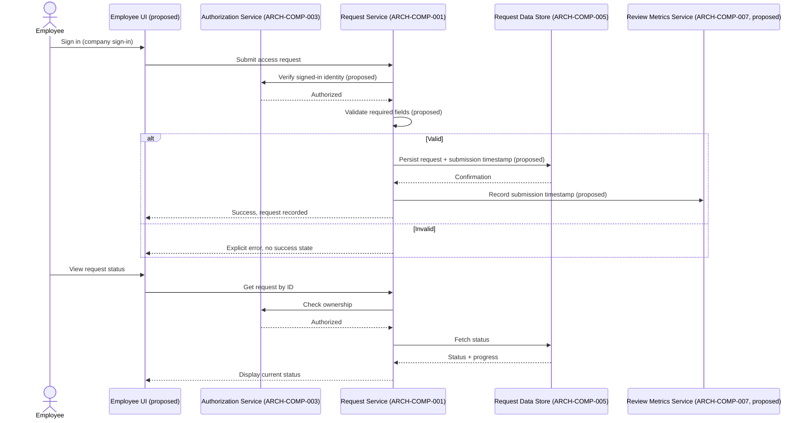

# Access Request Portal - Architecture Plan

## Executive Summary

This document defines the proposed architecture for an Access Request Portal addressing the confirmed business problem: employees cannot check access-request status and must contact IT for updates. The architecture supports four confirmed functional capabilities from PRD-69: employees viewing their own request status (PRD-FR-001), submitting access requests (PRD-FR-002), IT administrators reviewing and updating request status (PRD-FR-003), and managers tracking team requests within authorized scope (PRD-FR-004). All component names, specific technologies, data stores, endpoint shapes, and deployment topology shown below are not specified in the BRD/PRD and are marked "(proposed)." The PRD explicitly states API contracts, specific fields, status values, and team-relationship data sources remain to be defined; this document proposes a reasonable design for those gaps, each labeled accordingly.

## System Context

```mermaid
flowchart LR
    Employee([Employee]) -->|Signs in, submits/views requests| System[[Access Request Portal (proposed)]]
    ITAdmin([IT Administrator]) -->|Reviews, updates status| System
    Manager([Manager]) -->|Views team requests| System
    System -->|Authenticates via| SSO[Company Sign-In / Identity Provider]
    System -->|Reads team/manager relationships| HRSystem[(HR / Org Directory System (proposed))]
    System -->|Applies retention policy| RetentionPolicy[Data Retention Policy Engine (proposed)]
```

**Overview:** This diagram shows the Access Request Portal (proposed name) as a bounded system interacting with three confirmed human actor types (Employee, IT Administrator, Manager — all stakeholders per the BRD) and external systems required to satisfy confirmed requirements.

**Key Components:** Employee, IT Administrator, and Manager are confirmed stakeholders (BRD). The Company Sign-In/Identity Provider is confirmed as a constraint (BRD: "must use company sign-in"). The HR/Org Directory System is (proposed) as one possible way to satisfy PRD-FR-004's team-scope need; PRD-69 explicitly leaves "the authoritative source and update timing for employee-manager team relationships" as NEEDS CLARIFICATION, so this integration — including its existence, its authority, and its sync timing — is a proposal for stakeholder confirmation, not a confirmed decision. The Data Retention Policy Engine is (proposed) to satisfy PRD-NFR-002.

**Relationships:** All actors interact only through the Portal; no direct actor-to-actor data exchange is confirmed or proposed.

**Design Decisions:** Treating HR/Org Directory as an external system (proposed) rather than internal data avoids the Portal becoming the system of record for org structure, which is out of scope per the BRD ("Out of scope: change HR records"). Because the authoritative source is unconfirmed, the Team Scope Service (below) is designed to depend on this integration through a swappable interface rather than a hard-coded dependency.

**NFR Considerations:**
- **Scalability:** External identity/HR dependencies are decoupled, allowing independent scaling (proposed).
- **Performance:** Direct sign-in integration avoids redundant authentication hops (proposed).
- **Security:** Company sign-in enforced at the boundary satisfies PRD-NFR-001.
- **Reliability:** External system failures (HR directory, SSO) are isolated failure domains (proposed).
- **Maintainability:** Clear actor/system boundary simplifies future scope changes.

**Trade-offs:** Depending on an external HR directory (proposed) introduces integration risk versus owning team-relationship data internally, but internal ownership would conflict with "Out of scope: change HR records." This trade-off is contingent on stakeholders confirming an authoritative source at all.

**Risks and Mitigations:** Risk: HR directory data staleness could misassign manager scope (PRD-FR-004 edge case), and the source/timing of updates is not yet confirmed. Mitigation (proposed): scheduled sync with audit logging, pending confirmation of the authoritative source; until confirmed, Team Scope Service should fail closed (deny) rather than guess.

## Architecture Overview

The proposed architecture is a **layered, modular monolith-first design with clear service boundaries (proposed)**, favoring a single deployable unit for the initial phase to reduce operational complexity, with a migration path to extracted services if scale demands it. This pattern is chosen (proposed) because the PRD defines a bounded, four-capability system without confirmed requirements for independent scaling, polyglot persistence, or multi-team ownership that would justify microservices from day one.

## Component Architecture

```mermaid
flowchart TB
    subgraph UI["Presentation Layer (proposed)"]
        EmpUI[Employee Request UI (proposed)]
        ITUi[IT Review UI (proposed)]
        MgrUI[Manager Team View UI (proposed)]
    end
    subgraph App["Application Layer (proposed)"]
        ReqSvc[Request Service - ARCH-COMP-001 (proposed)]
        StatusSvc[Status Update Service - ARCH-COMP-002 (proposed)]
        AuthzSvc[Authorization Service - ARCH-COMP-003 (proposed)]
        TeamSvc[Team Scope Service - ARCH-COMP-004 (proposed)]
        MetricsSvc[Review Metrics / Reporting Service - ARCH-COMP-007 (proposed)]
    end
    subgraph Data["Data Layer (proposed)"]
        ReqDB[(Request Data Store - ARCH-COMP-005 (proposed))]
        AuditLog[(Audit/Retention Log - ARCH-COMP-006 (proposed))]
    end
    EmpUI --> AuthzSvc
    AuthzSvc --> ReqSvc
    ITUi --> AuthzSvc
    AuthzSvc --> StatusSvc
    MgrUI --> AuthzSvc
    AuthzSvc --> TeamSvc
    ReqSvc --> ReqDB
    StatusSvc --> ReqDB
    TeamSvc --> ReqDB
    StatusSvc --> AuditLog
    StatusSvc --> MetricsSvc
    MetricsSvc --> ReqDB
    TeamSvc -->|org scope lookup| HRSystem[(HR/Org Directory (proposed) - source unconfirmed)]
```

### Components (requirement IDs defined here)

- **ARCH-COMP-001 — Request Service (proposed).** Handles request submission and retrieval for the owning employee, invoked only after the Authorization Service confirms the caller's identity and ownership. Traces to PRD-FR-001 (view own request status), PRD-FR-002 (submit an access request).
- **ARCH-COMP-002 — Status Update Service (proposed).** Allows authorized IT administrators to review a request and record a status update, and retains prior status on failed updates. Traces to PRD-FR-003 (review requests and update status).
- **ARCH-COMP-003 — Authorization Service (proposed).** Enforces role- and scope-based access on every data-access path — submission, status reads, review reads/writes, and team reads — so users see or change only data they are authorized for. Traces to PRD-FR-001, PRD-FR-002, PRD-FR-003, PRD-FR-004 and PRD-NFR-001 (company sign-in and access control — confirmed).
- **ARCH-COMP-004 — Team Scope Service (proposed).** Resolves a manager's authorized team scope and filters team requests accordingly. Traces to PRD-FR-004 (track team requests).
- **ARCH-COMP-005 — Request Data Store (proposed).** Persists recorded requests, their status, and progress information, including submission and status-change timestamps. Traces to PRD-FR-001, PRD-FR-002, PRD-FR-003.
- **ARCH-COMP-006 — Audit/Retention Log (proposed).** Captures status-change history and supports retention-policy enforcement. Traces to PRD-NFR-002 (data retention — confirmed) and PRD-FR-003 (status update visibility).
- **ARCH-COMP-007 — Review Metrics / Reporting Service (proposed).** Records submission and initial-review timestamps and computes the percentage of requests reviewed within one business day, for reporting against the confirmed 90% target. Traces to PRD-NFR-003 (initial review target — confirmed target value; measurement/reporting mechanism proposed). **Open question preserved from PRD-69:** what counts as an "initial review" and how the business calendar is defined are explicitly NEEDS CLARIFICATION in the PRD; this service's timestamp/metric logic is a placeholder pending that definition.

**Overview:** Five application services sit behind a thin presentation layer, each owning a single confirmed capability or a clearly scoped supporting capability, backed by two shared data stores.

**Key Components:** See ARCH-COMP-001 through ARCH-COMP-007 above.

**Relationships:** All three primary application services (Request, Status Update, Team Scope) are invoked only after passing through the shared Authorization Service (ARCH-COMP-003), centralizing the access-control logic required by PRD-NFR-001 across submission, status reads, review actions, and team-scope reads alike. The Status Update Service emits a timestamped event to the Review Metrics Service on every status change.

**Design Decisions:** Centralizing authorization (proposed) as an inbound gate — rather than a check performed only on some paths — avoids duplicating scope-checking logic and ensures submission and review reads are checked the same way as status writes and team views, directly supporting the confirmed requirement that unauthorized data must never be disclosed (PRD-FR-001, PRD-FR-004 alternate flows). Separating Review Metrics (ARCH-COMP-007) from Status Update Service (proposed) avoids entangling reporting logic with the core status-update transaction.

**NFR Considerations:**
- **Scalability:** Services are independently extractable later (proposed).
- **Performance:** Shared authorization check is designed as an in-process library call in Phase 1 to avoid network latency (proposed).
- **Security:** Single enforcement point reduces the chance of an authorization bypass (proposed), addressing confirmed acceptance criteria that employees cannot view others' requests.
- **Reliability:** Status update failures retain the prior status per PRD-FR-003 alternate flow (confirmed requirement; implementation proposed via transactional update).
- **Maintainability:** Clear service boundaries map 1:1 to PRD functional requirements, simplifying future changes to a single capability.

**Trade-offs:** A modular monolith (proposed) trades independent deployability for simpler initial operations.

**Risks and Mitigations:** Risk: tight coupling between services and shared data store could complicate future extraction. Mitigation (proposed): enforce service-owned data access patterns (no cross-service direct table access) from Phase 1. Risk: the review-metric definition is not yet confirmed, so ARCH-COMP-007's output may need rework. Mitigation (proposed): store raw timestamps rather than pre-aggregated metrics, so the calculation can change without reloading data once "initial review" and business calendar are defined.

## Deployment Architecture

```mermaid
flowchart TB
    subgraph Internet["Public Zone"]
        Users[Employees / IT Admins / Managers]
    end
    subgraph DMZ["Security Zone: Edge (proposed)"]
        LB[Load Balancer / API Gateway (proposed)]
        WAF[Web Application Firewall (proposed)]
    end
    subgraph AppZone["Security Zone: Application (proposed)"]
        AppInstance1[Portal App Instance 1 (proposed)]
        AppInstance2[Portal App Instance 2 (proposed)]
    end
    subgraph DataZone["Security Zone: Data (proposed)"]
        DB[(Primary Request Database (proposed))]
        DBReplica[(Read Replica (proposed))]
    end
    subgraph External["External Integrations"]
        SSOProvider[Company SSO (confirmed constraint)]
        HRDir[HR/Org Directory (proposed) - authoritative source unconfirmed]
    end
    Users --> WAF --> LB
    LB --> AppInstance1
    LB --> AppInstance2
    AppInstance1 -->|authenticate| SSOProvider
    AppInstance2 -->|authenticate| SSOProvider
    AppInstance1 -->|authorize via app-tier Authorization Service, then| DB
    AppInstance2 -->|authorize via app-tier Authorization Service, then| DB
    DB --> DBReplica
    AppInstance1 -->|team-scope lookup, authorized only| HRDir
    AppInstance2 -->|team-scope lookup, authorized only| HRDir
```

**Overview:** A standard three-tier deployment (edge, application, data) with a single production environment shown; dev/staging environments mirror this topology (proposed).

**Key Components:** WAF and Load Balancer/API Gateway (proposed) terminate TLS and filter traffic before reaching application instances. Two application instances (proposed) provide basic redundancy and host the Authorization Service, which gates all outbound calls to the database and HR Directory. A primary database with a read replica (proposed) supports status-read scaling for employee/manager status views (PRD-FR-001, PRD-FR-004).

**Relationships:** All traffic flows through the WAF/LB before reaching application instances, which authenticate against SSO (confirmed) and, only after an authorization check, call the database or HR Directory (proposed) as external dependencies.

**Design Decisions:** Separating security zones (proposed) enforces network-level isolation between public-facing edge components and data stores, supporting PRD-NFR-001's access-control intent at the infrastructure layer. Authorization is shown explicitly on every data-zone-bound arrow (not just some) to keep this diagram consistent with the Component and Data Flow diagrams.

**NFR Considerations:**
- **Scalability:** Horizontal scaling of application instances behind the load balancer (proposed).
- **Performance:** Read replica offloads status-lookup traffic from the primary write path (proposed).
- **Security:** WAF and zone segmentation reduce attack surface (proposed); confirmed constraint requires company sign-in enforced at the application tier, with authorization enforced before every data-zone access.
- **Reliability:** Multiple app instances and a DB replica provide basic fault tolerance (proposed).
- **Maintainability:** Environment parity (dev/staging/production) reduces deployment surprises (proposed).

**Trade-offs:** Two instances/one replica is a minimal-HA baseline (proposed), not full multi-region resilience, balancing cost against the BRD's modest scale signals (no HA requirement stated).

**Risks and Mitigations:** Risk: single-region deployment is an availability risk. Mitigation (proposed): document a multi-region path in Final Phase.

## Data Flow

```mermaid
flowchart LR
    Emp[Employee] -->|1. Submit request data| AuthzSub{Authz: verify signed-in identity - ARCH-COMP-003 (proposed)}
    AuthzSub -->|Authorized| ReqSvc[Request Service - ARCH-COMP-001]
    AuthzSub -->|Not authorized| ErrorResp1[Reject, no success state]
    ReqSvc -->|2. Validate required fields (proposed)| Validate{Valid?}
    Validate -->|Yes| ReqDB[(Request Data Store - ARCH-COMP-005, incl. submission timestamp)]
    Validate -->|No| ErrorResp[Return error, no success state]
    Emp -->|3. View own request status| AuthzView{Authz: verify ownership - ARCH-COMP-003 (proposed)}
    AuthzView -->|Authorized| ReqDB
    AuthzView -->|Not authorized| ErrorResp2[Deny, no data disclosed]
    ReqDB -->|Persisted request + status| EmpView[Employee Status View]
    ITAdmin[IT Administrator] -->|4. Request review read| AuthzReview{Authz: verify IT admin role - ARCH-COMP-003 (proposed)}
    AuthzReview -->|Authorized| StatusSvc[Status Update Service - ARCH-COMP-002]
    AuthzReview -->|Not authorized| ErrorResp3[Reject review access]
    StatusSvc -->|5. Read request for review| ReqDB
    ITAdmin -->|6. Submit status update| AuthzWrite{Authz: verify IT admin role - ARCH-COMP-003 (proposed)}
    AuthzWrite -->|Authorized| StatusSvc
    AuthzWrite -->|Not authorized| ErrorResp4[Reject update, retain prior status]
    StatusSvc -->|7. Write status, retain prior on failure| ReqDB
    StatusSvc -->|8. Log change| AuditLog[(Audit/Retention Log - ARCH-COMP-006)]
    StatusSvc -->|9. Record review timestamp (proposed)| MetricsSvc[Review Metrics Service - ARCH-COMP-007 (proposed)]
    MetricsSvc -->|10. Compute % reviewed within target (proposed; "initial review" and business calendar definitions pending)| ReqDB
    Manager[Manager] -->|11. Request team view| AuthzTeam{Authz: resolve + verify authorized team scope - ARCH-COMP-003 (proposed)}
    AuthzTeam -->|Authorized| TeamSvc[Team Scope Service - ARCH-COMP-004]
    AuthzTeam -->|Not authorized / scope unresolvable| ErrorResp5[Deny, no team data disclosed]
    TeamSvc -->|12. Resolve scope| HRDir[(HR/Org Directory (proposed) - source unconfirmed)]
    TeamSvc -->|13. Filtered team requests| ReqDB
```

**Overview:** Every data-access path — submission, own-status viewing, IT review reads, status writes, and manager team views — passes through an explicit authorization check (proposed) before touching the Request Data Store, consistent with the confirmed non-disclosure and rejection requirements across PRD-FR-001 through PRD-FR-004.

**Key Components:** Validation gate (proposed) implements PRD-FR-002's alternate flow ("do not indicate that the request was successfully recorded" on failure). The Audit/Retention Log (ARCH-COMP-006, proposed) captures status-change history for PRD-NFR-002. The Review Metrics Service (ARCH-COMP-007, proposed) captures a timestamp at submission (step 1/2) and at first recorded status update (step 9) to support reporting against the confirmed 90%-within-one-business-day target; **what qualifies as the "initial review" event and the business calendar used to measure "one business day" remain NEEDS CLARIFICATION per PRD-69** — this service stores raw timestamps so the calculation itself can be finalized once those are defined, rather than committing to a specific formula now.

**Relationships:** Status updates (steps 4-7) pass through two authorization checks — one to access the request for review (step 4) and one to confirm the writer's role before the write (step 6) — and failures leave the prior status intact per PRD-FR-003. Manager team views (steps 11-13) are denied outright if team scope cannot be resolved, consistent with PRD-FR-004's alternate flow.

**Design Decisions:** Logging every status change (proposed) rather than only current state supports future audit/retention needs even though exact retention rules are not yet defined (PRD NEEDS CLARIFICATION). Capturing raw timestamps rather than a pre-computed "on-time/late" flag (proposed) avoids baking in an unconfirmed definition of "initial review."

**NFR Considerations:**
- **Scalability:** Read-heavy employee/manager views are separated from write-heavy IT update flow (proposed).
- **Performance:** Validation occurs before any persistence write to avoid wasted I/O (proposed).
- **Security:** An authorization check precedes every read and write shown in this diagram (proposed), directly supporting PRD-FR-003's "reject unauthorized update attempts" and PRD-FR-001/004's non-disclosure requirements.
- **Reliability:** Failed validation or failed updates never produce a false success state (confirmed requirement).
- **Maintainability:** Discrete numbered steps map directly to acceptance criteria, easing future traceability.

**Trade-offs:** Logging every change and every timestamp (proposed) increases storage versus simplicity of storing only current status, but is necessary to support PRD-NFR-003 reporting once its definition is finalized.

**Risks and Mitigations:** Risk: duplicate submissions (PRD-FR-002 edge case) could be misrecorded as separate requests. Mitigation (proposed): idempotency key or duplicate-detection check before persistence. Risk: reporting against the 90% target may be inaccurate until "initial review" and the business calendar are defined. Mitigation (proposed): publish raw timestamp data to stakeholders alongside any interim metric, flagged as provisional.

## Key Workflows



**Overview:** This sequence covers the primary confirmed journey from the business problem: submission followed by self-service status viewing without contacting IT, with an authorization check shown on both the submission path and the status-read path.

**Key Components:** Validation and persistence occur before any success confirmation; ownership authorization is checked before returning status to prevent viewing another employee's request (PRD-FR-001 acceptance criteria); a submission-timestamp is recorded (proposed) to feed the Review Metrics Service.

**Relationships:** The Employee UI never talks to the Data Store directly; all access routes through Request Service and Authorization Service, consistent with the layered design above.

**Design Decisions:** Synchronous confirmation on submission (proposed) matches the confirmed requirement that a successfully submitted request "is recorded and available to that employee for tracking." Recording the submission timestamp inline (proposed) at the moment of persistence, rather than retroactively, avoids clock-skew ambiguity for the Review Metrics Service.

**NFR Considerations:**
- **Scalability:** Stateless request/response flow supports horizontal scaling (proposed).
- **Performance:** Single round-trip submission and single round-trip status fetch minimize latency (proposed).
- **Security:** Authorization check on both submission and every status read prevents unauthorized disclosure (PRD-FR-001 confirmed).
- **Reliability:** Explicit error paths avoid ambiguous states on failure (confirmed).
- **Maintainability:** Clear step sequence simplifies future addition of notification workflows (not in current scope).

**Trade-offs:** Synchronous confirmation (proposed) is simpler than async/eventual-consistency confirmation but may not scale to very high submission volume; acceptable given no stated high-throughput requirement.

**Risks and Mitigations:** Risk: network failure between confirmation and UI could cause a user to resubmit. Mitigation (proposed): idempotent submission handling.

## Component Diagram

See **Component Architecture** above for the full Component Diagram (ARCH-COMP-001 through ARCH-COMP-007) and its explanation.

## Deployment Diagram

See **Deployment Architecture** above for the full Deployment Diagram and its explanation.

## Security

**Overview:** Security controls enforce the confirmed constraint "must use company sign-in and follow data-retention and access-control policies" and the explicit non-disclosure requirements across PRD-FR-001, PRD-FR-002, PRD-FR-003, and PRD-FR-004.

**Key Components:**
- Company Sign-In / SSO integration (confirmed) at the edge, before any portal function is reachable.
- Authorization Service (ARCH-COMP-003, proposed) enforcing role-based access (Employee/IT Administrator/Manager) and row-level scope: an employee's own requests, requests available to IT administrators for review (PRD-69 does not specify a reviewer-assignment model, so this scope is "any IT administrator may review any submitted request," not "assigned reviews" — proposed, pending confirmation), and a manager's authorized team scope.
- WAF (proposed) at the network edge.
- Audit/Retention Log (ARCH-COMP-006, proposed) for traceability of status changes, supporting PRD-NFR-002.
- Review Metrics Service (ARCH-COMP-007, proposed) for 90% initial-review target reporting, reading only timestamp data, not request content.

**Relationships:** Every data-access path shown in Component Architecture and Data Flow — submission, status reads, review reads, status writes, and team reads — routes through the Authorization Service before touching the Request Data Store; no path is exempt.

**Design Decisions:** Centralized, mandatory authorization checks (proposed) are chosen because the PRD repeatedly specifies "reject unauthorized update attempts," "do not disclose unauthorized request data," and "deny attempts to view requests outside the authorized scope" — all confirmed acceptance criteria — making a single enforcement point lower-risk than per-endpoint checks. The design intentionally avoids introducing a reviewer-assignment concept, since PRD-69 specifies only that "an IT administrator" (unspecified which one) can review a request.

**NFR Considerations:**
- **Scalability:** Stateless token-based sign-in (proposed) scales horizontally.
- **Performance:** Authorization decisions cached per-request (proposed) to avoid repeated lookups.
- **Security:** Role/scope checks on every read and write; company sign-in required before any function (confirmed); permitted status values restricted to an administrator-defined set (PRD NEEDS CLARIFICATION — exact values not yet defined).
- **Reliability:** Authorization failures fail closed (deny by default, proposed).
- **Maintainability:** Single authorization module simplifies policy updates as roles evolve, including if a reviewer-assignment model is adopted later.

**Trade-offs:** Fail-closed authorization (proposed) may occasionally block legitimate edge-case access until scope data (e.g., team relationships) is confirmed correct, favoring safety over availability. Not adopting an assignment model (proposed) is simpler but means all IT administrators can review all requests, which stakeholders may want to revisit.

**Risks and Mitigations:** Risk: stale or incorrect HR team-relationship data could incorrectly grant or deny manager access (PRD-FR-004 edge case, confirmed concern), and the authoritative source/update timing for that data is unconfirmed. Mitigation (proposed): scope check always reads current authorized scope at request time rather than caching long-term, and denies access (rather than guessing) if scope cannot be resolved.

## API

**Note:** The PRD explicitly states "The BRD does not specify API endpoints, payloads, response formats, or status codes. These remain to be defined during design." All endpoints below are therefore (proposed) and illustrative only.

| Endpoint (proposed) | Method (proposed) | Purpose | Authorization check (proposed) | Traces to |
|---|---|---|---|---|
| `/requests` (proposed) | POST | Submit a new access request | Verify signed-in identity | PRD-FR-002 |
| `/requests/mine` (proposed) | GET | List the signed-in employee's own requests | Verify ownership | PRD-FR-001 |
| `/requests/{id}` (proposed) | GET | View a single request's status/progress | Verify ownership | PRD-FR-001 |
| `/review/requests/{id}` (proposed) | GET | IT administrator reads a request for review | Verify IT administrator role | PRD-FR-003 |
| `/review/requests/{id}/status` (proposed) | PATCH | IT administrator records a status update | Verify IT administrator role | PRD-FR-003 |
| `/teams/requests` (proposed) | GET | Manager views requests within authorized team scope | Resolve and verify authorized team scope | PRD-FR-004 |

**Overview:** A REST-style API surface (proposed) supporting the four confirmed functional capabilities, with no payload/schema details confirmed by the BRD/PRD, and an explicit authorization check named for every endpoint.

**Key Components:** Each endpoint maps to exactly one confirmed functional requirement; the review-read (GET) and status-update (PATCH) endpoints are restricted to authorized IT administrators only (proposed enforcement), with no reviewer-assignment restriction since none is specified.

**Relationships:** All endpoints require a valid company sign-in session (confirmed constraint) and pass through the Authorization Service before data access.

**Design Decisions:** Separate `GET /requests/mine` and `GET /teams/requests` endpoints (proposed) keep employee and manager data-access paths distinct, reducing the chance of accidentally exposing out-of-scope data. Splitting the IT review read (`GET /review/requests/{id}`) from the update (`PATCH .../status`) (proposed) makes the review-read authorization check visible and auditable separately from the write check.

**NFR Considerations:**
- **Scalability:** Stateless REST endpoints scale behind the load balancer (proposed).
- **Performance:** Pagination on list endpoints (proposed) to handle growing request volume.
- **Security:** Every endpoint requires authentication and per-resource authorization (proposed); error responses avoid leaking existence of unauthorized records (confirmed requirement).
- **Reliability:** PATCH status updates are transactional — failure leaves the prior status unchanged (confirmed requirement).
- **Maintainability:** Versioned API paths (e.g., `/v1/...`, proposed) ease future contract evolution once real contracts are defined.

**Trade-offs:** Proposing a concrete API shape now (versus waiting for formal API design) provides a working baseline for implementation teams but will require revision once actual contracts are defined, as PRD-69 states.

**Risks and Mitigations:** Risk: proposed API shape may not match eventual design decisions, creating rework. Mitigation (proposed): treat this contract as a strawman for design review, not a final spec.

## Phased Development

### Phase 1: Initial Implementation

```mermaid
flowchart TB
    EmpUI[Employee UI (proposed)] --> Authz1[Authorization Service (proposed)]
    ITUi[IT Review UI (proposed)] --> Authz1
    Authz1 --> ReqSvc[Request + Status Service - combined ARCH-COMP-001/002 (proposed)]
    ReqSvc --> DB[(Single Request Database (proposed), incl. timestamps)]
```

**Explanation:** Phase 1 (proposed) delivers PRD-FR-001, PRD-FR-002, and PRD-FR-003 only — employee submission/status viewing and IT review/update, each behind an authorization check — as a single combined service with one database, deferring manager team-visibility (PRD-FR-004) and the separate Team Scope Service/HR Directory integration, since team-relationship sourcing is explicitly unresolved (PRD NEEDS CLARIFICATION). Submission and status-change timestamps are captured from Phase 1 (proposed) so Review Metrics reporting (ARCH-COMP-007) has data available once "initial review" and the business calendar are defined.

### Phase 2: Final Architecture

The Final Phase is the full architecture shown in **Component Architecture**, **Deployment Architecture**, and **Data Flow** above, including the Team Scope Service (ARCH-COMP-004), HR/Org Directory integration, read replica, Review Metrics Service (ARCH-COMP-007), and audit logging — fully realizing PRD-FR-004 and PRD-NFR-002/003.

### Migration Path

1. Confirm HR/Org Directory as the authoritative team-relationship source, including update timing (resolves PRD NEEDS CLARIFICATION) before building ARCH-COMP-004 (proposed).
2. Extract Team Scope Service from the combined Phase 1 service once team-relationship data is confirmed available (proposed).
3. Introduce the read replica and Audit/Retention Log when status-update volume or retention-policy requirements are formally defined (proposed).
4. Confirm the definition of "initial review" and the business calendar used for the 90% target (PRD NEEDS CLARIFICATION) before finalizing the Review Metrics Service's (ARCH-COMP-007) calculation; raw timestamps captured since Phase 1 remain usable regardless of which definition is chosen.
5. Split the combined Request+Status service into ARCH-COMP-001 and ARCH-COMP-002 if independent scaling or ownership becomes necessary (proposed).

## Non-Functional Requirements Analysis

### Scalability
Stateless application instances behind a load balancer (proposed) allow horizontal scaling; no specific throughput target is confirmed in the BRD/PRD, so scaling triggers are left to operational monitoring (proposed).

### Performance
No specific latency targets are confirmed. Proposed design minimizes round-trips (single submission call, single status-fetch call) and offloads reads to a replica in the Final Phase.

### Security
Confirmed: company sign-in and access-control policies (BRD constraint, PRD-NFR-001). Proposed implementation: centralized Authorization Service invoked on every data-access path (submission, status reads, review reads/writes, team reads), fail-closed checks, WAF, and no-disclosure error handling per PRD-FR-001/002/003/004 alternate flows.

### Reliability
Confirmed requirement: failed status updates must retain the prior status (PRD-FR-003). Proposed: transactional writes, two application instances, DB replica for read availability in Phase 2.

### Maintainability
Proposed: component boundaries map 1:1 to PRD functional requirements (ARCH-COMP-001 through 004), easing isolated changes; centralized authorization avoids duplicated policy logic.

### Reporting (90% Initial-Review Target)
Confirmed: at least 90% of requests must receive an initial review within one business day of submission (PRD-NFR-003). Proposed: the Review Metrics Service (ARCH-COMP-007) records a submission timestamp at persistence and a status-change timestamp at each IT administrator update, and computes an initial-review metric from these. **This remains provisional**: PRD-69 explicitly flags "what constitutes an 'initial review'" and "the reporting method for the 90% target" as NEEDS CLARIFICATION, and the business calendar used to measure "one business day" is not yet defined. The proposed design stores raw timestamps specifically so the final calculation can be applied retroactively once these are confirmed, rather than requiring re-instrumentation.

## Risks and Mitigations

| Risk | Related Requirement | Mitigation (proposed) |
|---|---|---|
| HR/Org Directory authoritative source and update timing unconfirmed, risking misassigned manager scope | PRD-FR-004 | Resolve scope at request time (not cached long-term); deny access if scope cannot be resolved |
| Duplicate request submissions misrecorded | PRD-FR-002 | Idempotency key / duplicate detection |
| Status values, "initial review" definition, and business calendar undefined | PRD-FR-003, PRD-NFR-003 | Escalate to stakeholders before Phase 1 build; capture raw timestamps now so metric logic can be finalized later |
| API contract not yet defined | All PRD-FR- items (Interfaces) | Treat proposed API table as a design-review starting point only |
| Single-region deployment availability risk | — (no BRD/PRD HA requirement stated) | Document multi-region option for a future phase |
| No reviewer-assignment model specified; any IT administrator can review any request | PRD-FR-003 | Confirm with stakeholders whether an assignment model is desired before implementing one |

## Technology Stack Recommendations

**All technology choices below are (proposed)**, as the BRD/PRD specify no technology stack:
- Application layer: any mainstream backend framework supporting modular service boundaries (proposed; language/runtime unspecified).
- Data store: a relational database supporting transactional status updates and timestamp storage (proposed).
- Identity: integration with the company's existing SSO/identity provider (confirmed constraint on *using* company sign-in; specific provider not stated).
- Edge: a managed load balancer/API gateway and WAF (proposed).

## Next Steps

1. Confirm with stakeholders: exact request fields, permitted status values, the definition of "initial review," and the business calendar used for the 90% target (all flagged NEEDS CLARIFICATION in PRD-69).
2. Confirm the authoritative source and sync cadence for employee-manager team relationships (PRD NEEDS CLARIFICATION) before building Team Scope Service (ARCH-COMP-004).
3. Confirm whether a reviewer-assignment model is desired for IT administrators, since PRD-69 does not specify one; the current proposal allows any IT administrator to review any submitted request.
4. Validate the proposed API contract (see **API** section) with design/API governance teams, since no contract is confirmed.
5. Review and approve the proposed security/authorization model — including its application to every data-access path — against company access-control policy (PRD-NFR-001).
6. Proceed with Phase 1 implementation scoped to PRD-FR-001, PRD-FR-002, and PRD-FR-003 only, capturing submission/status timestamps from the start to support later NFR-003 reporting.