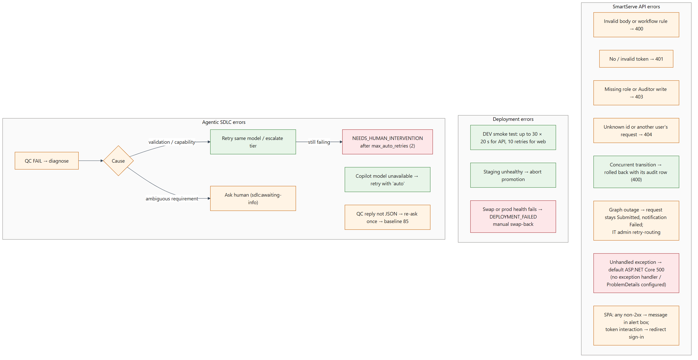

> Extracted from `source/Complete-Application-Solution-Document.md` by `tools/build.mjs`. Edit the chapter files, not this file.

# Error Handling and Resilience {#error-handling-resilience}

| Concern | Current behaviour | Recommendation |
|---|---|---|
| API errors | Explicit 400/404; automatic 400 for invalid models; 403 from policies; unhandled exceptions return 500 without ProblemDetails | `UseExceptionHandler` + `AddProblemDetails`; log with correlation ID |
| Database transience | EF Core SQL Server provider without `EnableRetryOnFailure` | Enable retry-on-failure with execution strategies |
| Consistency | Status change and audit row saved in **one** `SaveChanges`; tested on SQLite | Keep; add a SQL Server test |
| Concurrency | GUID concurrency tokens on requests and notification records; a losing transition returns 400 and rolls back with its audit row | Return 409 instead of 400 for concurrent changes |
| External services (Graph) | Directory outage keeps the request *Submitted* and records *Failed*; mail failures recorded per message; no automatic retry | IT-admin `retry-routing` exists for routing; consider automatic retry with back-off for e-mail |
| Idempotency | POSTs are not idempotent (duplicate submissions possible) | Idempotency key or duplicate detection |
| Client | SPA shows the error text; interactive sign-in on token expiry; no retry | Retry idempotent GETs with back-off; friendlier messages |
| Startup | `MigrateAsync` and seeding at startup; Key Vault provider failure stops the app | Run migrations in the pipeline for multi-instance scale-out |
| Deployments | DEV smoke test waits up to 10 minutes; production failure stops with `DEPLOYMENT_FAILED` | Optional automatic swap-back after a failed post-swap health check |
| Agentic SDLC | QC diagnosis, model escalation, `auto` fallback, JSON re-ask, patch persistence, fail-safe comments with retries, hand-off to CI/CD after code | Keep; add per-stage timeouts in the job |

Table: Table 24.1 — Error handling and resilience

# Operational Runbook {#operational-runbook}

| Issue | Symptoms | Possible cause | Validation steps | Resolution | Escalation | Prevention |
|---|---|---|---|---|---|---|
| Application unavailable | Portal or API returns 5xx/timeout | Crash at startup (Key Vault, DB, missing connection string), plan outage, bad deployment | `az webapp log tail`; App Insights failures; `curl https://<API_HOST>/health` (401 = running, 5xx/timeout = down) | Restart; redeploy previous commit; fix configuration | Platform team → Azure support | Alerts on 5xx; staged rollout |
| API failure (500) | Errors in UI; exceptions in App Insights | Unhandled exception, DB error | App Insights *Failures* by operation | Hotfix; roll back | Backend owner | Exception handler, tests |
| Authentication failure | 401 for all users after sign-in | Wrong `AzureAd` settings, audience mismatch, wrong token version | Decode the token (aud, iss, roles) in a safe tool; compare with `AzureAd__ClientId` | Correct the app registration or settings | Identity team | Configuration validation at startup |
| Consent blocked | "Need admin approval" at sign-in | Tenant restricts user consent | Check pre-authorization on the API app registration | Pre-authorize the SPA; or admin consent | Identity team | Keep pre-authorization in `setup-dev.ps1` |
| Authorization failure | 403 for valid users | Missing app-role assignment; Auditor role blocks writes | Check the `roles` claim | Assign roles in Entra ID | Identity team / AppAdmin | Documented role-assignment process |
| Database connectivity failure | `/health` 503; SQL exceptions | Private endpoint or DNS misconfigured, identity not SQL admin, DTU exhaustion, outage | App Insights dependency failures; resolve the SQL host name from the app (Kudu console) to a private IP; SQL metrics | Fix DNS zone link or endpoint; scale; fail over | DBA / platform | Keep networking in Bicep; alerts |
| Graph failure | Access requests stay *Submitted*; notifications *Failed* | Graph permissions missing, sender not set, Graph outage | `NotificationRecords` reasons; App Insights dependency calls to `graph.microsoft.com` | Grant permissions / set sender; IT admin `retry-routing` | Identity team | Alert on *Failed* notifications |
| External service failure (Entra / Key Vault) | Startup failure or token validation errors | Service incident, RBAC change, private endpoint issue | Azure status; Key Vault logs; role assignments | Restore RBAC; retry | Platform / Microsoft support | Diagnostic settings, alerts |
| AI service failure (SDLC only) | Stage comment "generation failed"; QC unavailable | Copilot token expired, model not available | Workflow logs; `COPILOT_GITHUB_TOKEN` validity | Rotate token; `/model select` another model | Platform team | Token expiry monitoring |
| High latency | Slow UI; long request durations | B1 plan, DTU limits, large unpaged lists | App Insights performance; SQL DTU % | Scale up/out; add paging and indexes | Backend / platform | Load tests, autoscale |
| Deployment failure | Workflow red; `DEPLOYMENT_FAILED` | Azure login (OIDC subject mismatch), unregistered resource provider, policy denial, Bicep error, failed smoke test | Workflow logs; `az deployment operation group list` | Fix and re-run; swap back if production | Release manager | Pre-deployment validation (what-if) |
| Configuration failure | Startup exceptions; wrong origins / audience | Missing or placeholder settings | `az webapp config appsettings list` (redact values) | Correct the settings in Bicep or `appsettings.json` and redeploy | Platform | Configuration in IaC; startup validation |
| Secret expiration | Key Vault / SQL / token errors; SDLC token failures | Expired PAT or secret | Key Vault expiry dates; token expiry | Rotate; update secret | Security / platform | Expiry alerts; prefer MI / OIDC |
| Storage failure | (No code uses storage today) | — | — | — | — | Implement when attachments are added |
| Rollback | Bad release in production | Defect after swap | Production `/health`, error rates | Slot swap back (§28); redeploy previous web build | Release manager | Smoke tests, canary checks |

Table: Table 29.1 — Operational runbook
