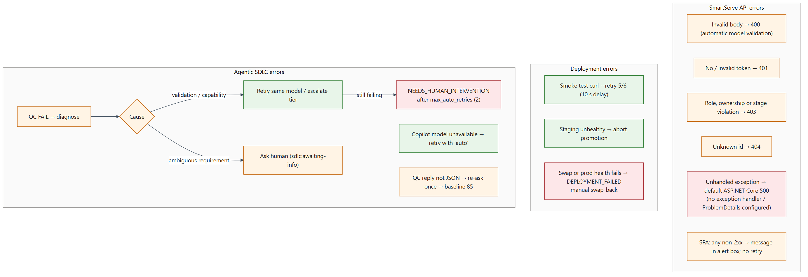

> Extracted from `source/Complete-Application-Solution-Document.md` by `tools/build.mjs`. Edit the chapter files, not this file.

# Error Handling and Resilience {#error-handling-resilience}

| Concern | Current behaviour | Recommendation |
|---|---|---|
| API errors | Explicit 400/403/404; automatic 400 for invalid models; unhandled exceptions return 500 without ProblemDetails | `UseExceptionHandler` + `AddProblemDetails`; log with correlation ID |
| Database transience | EF Core SQL Server provider without `EnableRetryOnFailure` | Enable retry-on-failure; pair it with execution strategies for the two-step save (request + audit) |
| Consistency | Request change and audit row saved in **two** `SaveChangesAsync` calls; a failure between them leaves an unaudited change | Save both in one unit of work / transaction |
| Concurrency | No concurrency token; simultaneous decisions can race | Add a `rowversion` concurrency token and handle 409 |
| Idempotency | POSTs are not idempotent (duplicate submissions possible) | Idempotency key or duplicate detection (open question in TASK-23) |
| Client | SPA shows the error text; no retry or back-off | Retry idempotent GETs with back-off; friendly messages |
| Startup | `Migrate()` at startup; Key Vault provider failure stops the app | Run migrations in the pipeline; health-gate the slot before swap (already done) |
| Deployments | Smoke tests retry 5–6 times; production failure stops with `DEPLOYMENT_FAILED` | Optional automatic swap-back after a failed post-swap health check |
| Agentic SDLC | QC diagnosis, model escalation, `auto` fallback, JSON re-ask, patch persistence, fail-safe comments with retries | Keep; add per-stage timeouts in the job |

Table: Table 24.1 — Error handling and resilience

# Operational Runbook {#operational-runbook}

| Issue | Symptoms | Possible cause | Validation steps | Resolution | Escalation | Prevention |
|---|---|---|---|---|---|---|
| Application unavailable | Portal or API returns 5xx/timeout; App Service health check failing | Crash at startup (Key Vault, DB), plan outage, bad deployment | `az webapp log tail`; App Insights failures; `curl https://<API_HOST>/health` | Restart; swap back; fix configuration | Platform team → Azure support | Alerts on `/health` and 5xx; staged rollout |
| API failure (500) | Errors in UI; exceptions in App Insights | Unhandled exception, DB error | App Insights *Failures* by operation; correlation ID from audit | Hotfix; roll back | Backend owner | Exception handler, tests |
| Authentication failure | 401 for all users | Wrong `AzureAd` settings, audience mismatch, expired consent, SPA without sign-in | Decode the token (aud, iss, roles) in a safe tool; compare with app settings | Correct the app registration or settings | Identity team | Configuration validation at startup; sign-in UI |
| Authorization failure | 403 for valid users | Missing app-role assignment, wrong stage role | Check the `roles` claim; request status / stage | Assign roles in Entra ID | Identity team / AppAdmin | Documented role-assignment process |
| Database connectivity failure | `/health` Unhealthy; SQL exceptions | MI user missing, firewall, DTU exhaustion, outage | App Insights dependency failures; SQL metrics; `az sql db show` | Create the MI user; scale; fail over | DBA / platform | Provision the MI user in automation; alerts |
| External service failure (Entra / Key Vault) | Startup failure or token validation errors | Service incident, RBAC change | Azure status; Key Vault logs; role assignments | Restore RBAC; retry | Platform / Microsoft support | Diagnostic settings, alerts |
| AI service failure (SDLC only) | Stage comment "generation failed"; QC unavailable | Copilot token expired, model not available | Workflow logs; `COPILOT_GITHUB_TOKEN` validity | Rotate token; `/model select` another model | Platform team | Token expiry monitoring |
| High latency | Slow UI; long request durations | B1 plan, DTU limits, large unpaged lists | App Insights performance; SQL DTU % | Scale up/out; add paging and indexes | Backend / platform | Load tests, autoscale |
| Deployment failure | Workflow red; `DEPLOYMENT_FAILED` | Bicep error, publish error, failed health | Workflow logs; release evidence pack | Fix and rerun; swap back if production | Release manager | Pre-deployment validation (what-if) |
| Configuration failure | Startup exceptions; wrong origins / audience | Missing app settings | `az webapp config appsettings list` (redact values) | Correct the settings in Bicep and redeploy | Platform | Configuration in IaC; startup validation |
| Secret expiration | Key Vault / SQL / token errors; SDLC token failures | Expired PAT or secret | Key Vault expiry dates; token expiry | Rotate; update secret | Security / platform | Expiry alerts; prefer MI / OIDC |
| Storage failure | (No code uses storage today) | — | — | — | — | Implement when attachments are added |
| Rollback | Bad release in production | Defect after swap | Production `/health`, error rates | Slot swap back (§28); redeploy previous web build | Release manager | Smoke tests, canary checks |

Table: Table 29.1 — Operational runbook
