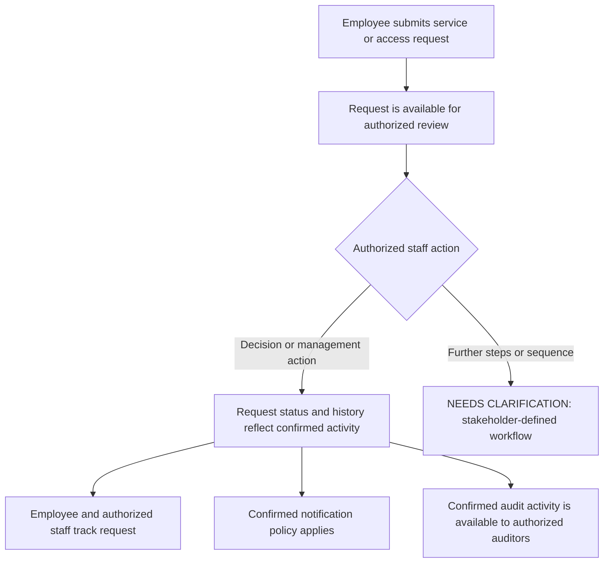

# Product Requirements Document (PRD / FSD)

## Overview

This PRD derives from the approved BRD-19.md and describes the functional requirements for SmartServe, a portal for employee IT service and access requests. It covers submission, review and disposition, tracking, role permissions, notifications, and audit information. Unconfirmed business rules are recorded as questions rather than treated as settled behavior.

The stated environment constraints are React and TypeScript, a .NET 8 Web API, Microsoft Entra ID authentication, and Azure SQL through Entity Framework Core. API authorization must enforce permissions; secrets must use managed identity and Azure Key Vault and must not be stored in source control.

## Traceability Summary

| PRD ID | Derives from (BRD) | Title |
|---|---|---|
| PRD-FR-001 | BRD-REQ-001 | Request submission |
| PRD-FR-002 | BRD-REQ-002 | Request review and disposition |
| PRD-FR-003 | BRD-REQ-003 | Request tracking and history |
| PRD-FR-004 | BRD-REQ-004 | Role-based permissions |
| PRD-FR-005 | BRD-REQ-005 | Notifications |
| PRD-FR-006 | BRD-REQ-006 | Audit information |

## Functional Requirements

### Request submission

- **ID:** PRD-FR-001
- **Source:** BRD-REQ-001
- **Description:** The portal must enable employees to submit IT service and access requests. Request types, required information, and submission steps remain subject to stakeholder confirmation.
- **Preconditions:** The employee is authenticated. Any further eligibility rules are **NEEDS CLARIFICATION**.
- **Main flow:** The employee starts a request, provides the confirmed information for its type, submits it, and receives confirmation that it was received.
- **Alternate / error flows:** The portal must explain validation failures and allow the employee to correct the request. Behavior for unavailable services, duplicate submissions, or failed submission is **NEEDS CLARIFICATION**.
- **Edge cases:** Request types, required fields, attachments, draft handling, duplicate detection, and submission eligibility are **NEEDS CLARIFICATION**.
- **Acceptance criteria:** For each request type, stakeholders confirm the required information and submission workflow, or the unresolved items are documented as questions. A successfully submitted request is available for subsequent review and tracking.
- **Interfaces touched:** Employee request-submission screens and the request submission API contract; specific screens, fields, and endpoint details are **NEEDS CLARIFICATION**.

### Request review and disposition

- **ID:** PRD-FR-002
- **Source:** BRD-REQ-002
- **Description:** The portal must support authorized staff in reviewing and managing submitted requests, including approval and rejection where applicable. Which roles may act, the applicable actions, and any approval sequence require stakeholder confirmation.
- **Preconditions:** A request has been submitted. The acting user is authenticated and authorized for the confirmed action.
- **Main flow:** An authorized reviewer accesses a request, reviews its available information, and takes an allowed action. The portal records the resulting decision or management action.
- **Alternate / error flows:** The portal denies unauthorized actions. Behavior for requests requiring more information, reassignment, escalation, or further approval is **NEEDS CLARIFICATION**.
- **Edge cases:** Approval sequence, multiple reviewers, conflicting decisions, withdrawal, reopening, and decision-change rules are **NEEDS CLARIFICATION**.
- **Acceptance criteria:** Stakeholders confirm which roles may review, approve, reject, or otherwise manage each request type and specify any required sequence. Unconfirmed rules are recorded as questions, not assumed.
- **Interfaces touched:** Staff request-review screens and API operations for permitted actions; exact actions, routes, and response contracts are **NEEDS CLARIFICATION**.

### Request tracking and history

- **ID:** PRD-FR-003
- **Source:** BRD-REQ-003
- **Description:** The portal must provide request status and history to employees and authorized staff, according to stakeholder-defined visibility and retention rules.
- **Preconditions:** A request exists; the user is authenticated and permitted to view it.
- **Main flow:** The user views an authorized request and its current status and available history.
- **Alternate / error flows:** The portal denies access when the user is not authorized. Status-unavailable and history-unavailable behavior is **NEEDS CLARIFICATION**.
- **Edge cases:** Status values, status transitions, history events, visibility by role, and how changes appear in history are **NEEDS CLARIFICATION**.
- **Acceptance criteria:** Stakeholders define statuses, who can view them, and which request events or changes must be retained. The requirements document records these decisions or identifies unresolved items as questions.
- **Interfaces touched:** Request detail and history views, plus API read operations; exact status and history data contracts are **NEEDS CLARIFICATION**.

### Role-based permissions

- **ID:** PRD-FR-004
- **Source:** BRD-REQ-004
- **Description:** The portal must define and enforce permissions for employees, managers, security reviewers, IT administrators, application administrators, and auditors. The API must enforce authorization; UI restrictions alone are insufficient.
- **Preconditions:** The user is authenticated. Role assignment and any role-combination rules are **NEEDS CLARIFICATION**.
- **Main flow:** The portal determines whether a user may perform an action or access information, and the API permits or denies the operation accordingly.
- **Alternate / error flows:** The API rejects unauthorized operations. Handling of missing, conflicting, or changed role assignments is **NEEDS CLARIFICATION**.
- **Edge cases:** Scope of access to requests, information visibility, overlapping roles, and administrative delegation are **NEEDS CLARIFICATION**.
- **Acceptance criteria:** A stakeholder-validated permission matrix specifies each role’s permitted actions and information access. Each protected API operation enforces that policy independently of UI behavior.
- **Interfaces touched:** Authenticated UI states and all protected API operations. Authentication uses Microsoft Entra ID; role and permission contracts are **NEEDS CLARIFICATION**.

### Notifications

- **ID:** PRD-FR-005
- **Source:** BRD-REQ-005
- **Description:** Notification needs for request submission, review, decisions, and status changes must be defined before notification behavior is treated as settled.
- **Preconditions:** A stakeholder-confirmed notification event and policy exist.
- **Main flow:** For each confirmed event, the portal sends the agreed notification to the agreed recipients through the agreed channel.
- **Alternate / error flows:** Retry, delivery failure, and duplicate-notification behavior are **NEEDS CLARIFICATION**.
- **Edge cases:** Recipient changes, notification preferences, sensitive information in messages, and delivery timing are **NEEDS CLARIFICATION**.
- **Acceptance criteria:** Stakeholders identify notification events, recipients, and required channels, or each unresolved item is recorded as a question. No unconfirmed trigger, recipient, or channel is assumed.
- **Interfaces touched:** Notification content and delivery interfaces, if confirmed; channel, templates, and integration contracts are **NEEDS CLARIFICATION**.

### Audit information

- **ID:** PRD-FR-006
- **Source:** BRD-REQ-006
- **Description:** The portal must capture request and access activity needed for authorized audit review. Activity scope, auditor access, and retention expectations require stakeholder confirmation.
- **Preconditions:** An auditable activity occurs; applicable recording rules have been confirmed.
- **Main flow:** The portal records confirmed activity and makes it available to authorized auditors according to the confirmed access rules.
- **Alternate / error flows:** Access to audit information is denied to unauthorized users. Audit-record failure handling and notification are **NEEDS CLARIFICATION**.
- **Edge cases:** Required event details, access to sensitive information, record immutability, retention, and export needs are **NEEDS CLARIFICATION**.
- **Acceptance criteria:** Stakeholders define the activity to be recorded, auditor access, and retention expectations, or document each unresolved item as a question.
- **Interfaces touched:** Audit information available to authorized auditors and the system’s activity-recording contract; event schema and audit interface are **NEEDS CLARIFICATION**.

## Business Workflow

The following is a high-level workflow derived from the BRD. It does not establish approval rules, status names, or notification triggers.

**NEEDS CLARIFICATION:** Request lifecycle stages, who reviews each request type, approval sequence, rejection and other disposition behavior, status transitions, and conditions for completion.

## Interfaces

- **Employee UI:** Request submission and request tracking/history. Request types, fields, screens, and visible status details are **NEEDS CLARIFICATION**.
- **Staff UI:** Request review and management for authorized roles. Role-specific actions and information visibility are **NEEDS CLARIFICATION**.
- **Auditor UI or access surface:** Audit information for authorized auditors. Search, filtering, and export needs are **NEEDS CLARIFICATION**.
- **API:** The .NET 8 Web API must support the confirmed request, review, tracking, permission, notification, and audit behaviors. Endpoint paths, payloads, and status codes are **NEEDS CLARIFICATION**; this PRD does not prescribe them.
- **Identity and data constraints:** Authentication uses Microsoft Entra ID. Data is stored in Azure SQL through Entity Framework Core. API authorization is required. Secrets must use managed identity and Azure Key Vault and must not be stored in source control.
- **Data model:** Request types, fields, statuses, history events, role mappings, notification records, and audit records require stakeholder confirmation before their contracts can be specified.

## Validation

- Validate request inputs against the stakeholder-confirmed fields and rules for the relevant request type. Those fields and rules are **NEEDS CLARIFICATION**.
- Enforce authorization at the API for each protected operation and information access, based on the stakeholder-validated permission matrix.
- Return an appropriate denial for unauthorized operations; exact error contract and user-facing wording are **NEEDS CLARIFICATION**.
- Define behavior for malformed requests, missing required information, unavailable services, and persistence failures as part of the confirmed API and UI contracts.
- Define notification delivery failure and audit-record failure handling with stakeholders; neither behavior is established by the BRD.
- Record unresolved validation rules, approval policies, status behavior, notification policies, and audit expectations as questions rather than assumptions.

## Out of Scope

- Establishing approval rules, approval sequences, service levels, request statuses, or notification triggers without stakeholder confirmation.
- Defining request categories, forms, or data fields not established by stakeholders.
- Selecting or designing technical implementation details beyond the stated technology constraints.
- Implementing or configuring the portal.