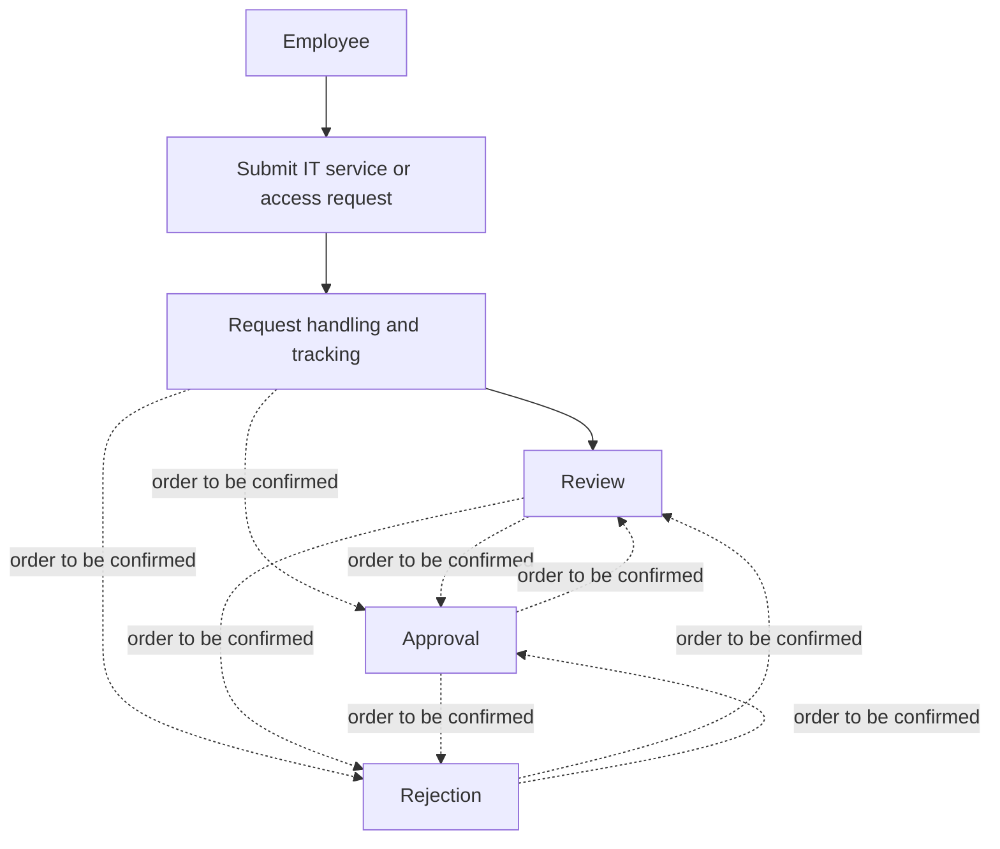

# Product Requirements Document (PRD / FSD)

## Overview

This PRD defines SmartServe portal capabilities based on the approved BRD-23. It covers employee IT service and access requests, request handling, role permissions, notifications, and the stated platform and security constraints. Unspecified workflow rules and targets remain open questions.

## Traceability Summary

| PRD ID | Derives from (BRD) | Title |
|---|---|---|
| PRD-FR-001 | BRD-REQ-001 | Employee request submission |
| PRD-FR-002 | BRD-REQ-002 | Request review and disposition |
| PRD-FR-003 | BRD-REQ-003 | Role permissions |
| PRD-FR-004 | BRD-REQ-004 | Notifications |
| PRD-NFR-001 | BRD-REQ-005 | Authentication |
| PRD-NFR-002 | BRD-REQ-006 | Server-side role authorization |
| PRD-NFR-003 | BRD-REQ-007 | Data platform |
| PRD-NFR-004 | BRD-REQ-008 | Secret management |
| PRD-NFR-005 | BRD-REQ-009 | Request history and audit information |

## Functional Requirements

### PRD-FR-001 — Employee request submission
- **Source:** BRD-REQ-001
- **Description:** SmartServe must provide employee workflows for submitting IT service requests and access requests.
- **Preconditions:** Not specified in the BRD. Required preconditions, if any, are an open question.
- **Main flow:** The portal supports an employee workflow to submit an IT service request or an access request.
- **Alternate / error flows:** Not specified in the BRD.
- **Edge cases:** Required request fields and other edge cases are open questions.
- **Acceptance criteria:** The requirements describe employee request-submission workflows for both IT service and access requests.
- **Interfaces touched:** Employee-facing portal workflow; request data details are not specified.

### PRD-FR-002 — Request review and disposition
- **Source:** BRD-REQ-002
- **Description:** SmartServe must support the request handling capabilities of review, approval, rejection, and tracking. Their rules, order, and status expectations are not defined by this requirement.
- **Preconditions:** Not specified in the BRD. Whether an existing request is required for review or disposition is an open question.
- **Main flow:** The portal supports review, approval, rejection, and tracking of requests; the applicable workflow and relationships among these activities remain to be defined.
- **Alternate / error flows:** Not specified in the BRD.
- **Edge cases:** Approval rules, routing, and request statuses are open questions.
- **Acceptance criteria:** The requirements address review, approval, rejection, and tracking without presuming unresolved rules or status expectations.
- **Interfaces touched:** Request handling and tracking capabilities; specific screens, endpoints, and statuses are not specified.

### PRD-FR-003 — Role permissions
- **Source:** BRD-REQ-003
- **Description:** SmartServe must define role permissions for employees, managers, security reviewers, IT administrators, application administrators, and auditors. Specific permissions for each role remain to be defined.
- **Preconditions:** Role assignment and any role-combination rules are not specified in the BRD.
- **Main flow:** The portal’s role-permission requirements cover each stakeholder group listed in the source requirement.
- **Alternate / error flows:** Not specified in the BRD.
- **Edge cases:** The permissions and access boundaries for each role are open questions.
- **Acceptance criteria:** The requirements cover role permissions for all six listed stakeholder groups.
- **Interfaces touched:** Role-aware portal capabilities and API authorization; detailed permission mappings are not specified.

### PRD-FR-004 — Notifications
- **Source:** BRD-REQ-004
- **Description:** SmartServe must include notification needs in its requirements for request handling. Which events trigger notifications and who receives them remain undecided.
- **Preconditions:** Not specified in the BRD.
- **Main flow:** The requirements identify notifications as a portal need without defining triggers or recipients.
- **Alternate / error flows:** Not specified in the BRD.
- **Edge cases:** Notification channels, delivery expectations, triggers, and recipients are open questions.
- **Acceptance criteria:** The requirements identify notification needs and record undecided details as open questions.
- **Interfaces touched:** Notification capability; channels and contracts are not specified.

## Non-Functional Requirements

### PRD-NFR-001 — Authentication
- **Source:** BRD-REQ-005
- **Requirement:** SmartServe must use Microsoft Entra ID for authentication.
- **Acceptance criteria:** The requirements specify Microsoft Entra ID authentication.
- **Interfaces / constraints:** Authentication integration; protocol and configuration details are not specified.

### PRD-NFR-002 — Server-side role authorization
- **Source:** BRD-REQ-006
- **Requirement:** The .NET Web API must enforce authorization based on user roles; authorization must not rely only on the UI.
- **Acceptance criteria:** The requirements specify API-side enforcement of role-based authorization.
- **Interfaces / constraints:** API authorization and role permissions; detailed role-to-action mappings remain open.

### PRD-NFR-003 — Data platform
- **Source:** BRD-REQ-007
- **Requirement:** SmartServe data must be stored in Azure SQL through Entity Framework Core.
- **Acceptance criteria:** The requirements specify Azure SQL and Entity Framework Core for data storage.
- **Interfaces / constraints:** Data persistence; schema and data model are not specified.

### PRD-NFR-004 — Secret management
- **Source:** BRD-REQ-008
- **Requirement:** Secrets must use managed identity and Azure Key Vault and must not be placed in source control.
- **Acceptance criteria:** The requirements specify managed identity and Azure Key Vault for secrets and prohibit storing secrets in source control.
- **Interfaces / constraints:** Secret management; specific secrets and configuration details are not specified.

### PRD-NFR-005 — Request history and audit information
- **Source:** BRD-REQ-009
- **Requirement:** SmartServe requirements must include request history and audit information. The specific information, access needs, and retention expectations are not defined.
- **Acceptance criteria:** The requirements identify request history and audit information needs and record retention and other unspecified targets as open questions.
- **Interfaces / constraints:** Request history and audit information; data details and retention targets are open questions.

## Business Workflow

The diagram shows the activities the portal must address, not a prescribed sequence among review, approval, and rejection. Dashed transitions are intentionally undefined.

## Interfaces

- **API endpoints:** No endpoint methods, paths, request or response formats, or status codes are specified in the BRD.
- **UI screens / states:** Employee submission, request handling, and tracking capabilities are in scope. Specific screens and status labels are not specified.
- **Data model:** Azure SQL through Entity Framework Core is required. Request fields, history details, and audit data elements are open questions.
- **Notifications:** Notification needs are in scope; triggers, recipients, and channels are open questions.
- **Platform constraints:** The application uses a React and TypeScript frontend and a .NET 8 Web API.

## Validation

- The BRD does not define request-field validation rules, required fields, or validation feedback.
- Authentication must use Microsoft Entra ID; API authorization must be role-based and enforced server-side.
- The permissions granted to each stakeholder role remain to be defined.
- Error responses, notification failures, and other operational error handling are not specified.
- Performance, availability, and retention targets must not be inferred; they remain open questions.

## Out of Scope

- Defining approval rules, reviewers, routing, or the order of review, approval, and rejection.
- Defining required request fields or request status labels and expectations.
- Specifying notification triggers, recipients, or delivery channels.
- Defining detailed role-to-action permission mappings.
- Setting performance, availability, or retention targets.
- Implementation details beyond the stated technology and security constraints.

## Open Questions / Assumptions

- **NEEDS CLARIFICATION:** What information must employees provide for each request type?
- **NEEDS CLARIFICATION:** Which approval rules, reviewers, and routing paths apply to each request type?
- **NEEDS CLARIFICATION:** What request statuses and status expectations should users see?
- **NEEDS CLARIFICATION:** Which events require notifications, and who should receive them?
- **NEEDS CLARIFICATION:** What request history and audit details must be captured and made available?
- **NEEDS CLARIFICATION:** What are the required performance, availability, and retention targets?
- **NEEDS CLARIFICATION:** What permissions apply to each stakeholder role?
- **NEEDS CLARIFICATION:** What API endpoints, UI states, data fields, and error responses are required?
- **ASSUMPTION:** None added beyond the approved BRD.