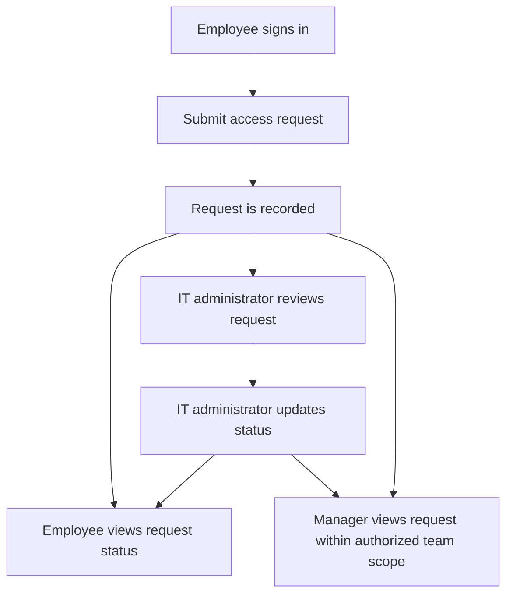

# Product Requirements Document (PRD / FSD)

## Overview

This PRD derives from approved `BRD-69.md` and specifies access-request submission, status tracking, IT review, and manager visibility. It does not define additional workflows or integrations beyond the BRD.

## Traceability Summary

| PRD ID | Derives from (BRD) | Title |
|---|---|---|
| PRD-FR-001 | BRD-REQ-001 | View own request status |
| PRD-FR-002 | BRD-REQ-002 | Submit an access request |
| PRD-FR-003 | BRD-REQ-003 | Review requests and update status |
| PRD-FR-004 | BRD-REQ-004 | Track team requests |

## Functional Requirements

### PRD-FR-001 — View own request status
- **Source:** BRD-REQ-001
- **Description:** An employee can locate submitted access requests and view each request’s current status and progress.
- **Preconditions:** The employee is signed in using company sign-in.
- **Main flow:** The employee opens their requests, selects a submitted request, and sees its current status and available progress information.
- **Alternate / error flows:** If no requests are available, show an empty state. If a request cannot be retrieved, show an error without exposing unauthorized request data.
- **Edge cases:** A request with no status update must still be identifiable as submitted; the exact display value is to be defined.
- **Acceptance criteria:** An employee can locate a submitted request and see its current status without contacting IT. The employee cannot view another employee’s request through this function.
- **Interfaces touched:** Employee request list and request details; request status and progress data.

### PRD-FR-002 — Submit an access request
- **Source:** BRD-REQ-002
- **Description:** An employee can submit an access request. A successfully submitted request is recorded and available to that employee for tracking.
- **Preconditions:** The employee is signed in using company sign-in.
- **Main flow:** The employee enters the required request information, submits it, and receives confirmation that it was recorded.
- **Alternate / error flows:** If required information is missing or submission fails, explain the issue and do not indicate that the request was successfully recorded.
- **Edge cases:** Repeated submissions must not be presented as one successful submission unless the system has confirmed they refer to the same recorded request.
- **Acceptance criteria:** A submitted request is recorded and can subsequently be found and tracked by its submitter.
- **Interfaces touched:** Request submission screen; recorded request data; employee request list.

### PRD-FR-003 — Review requests and update status
- **Source:** BRD-REQ-003
- **Description:** An IT administrator can review a submitted access request and record a status update that is visible to users authorized to see that request.
- **Preconditions:** The user is signed in and authorized as an IT administrator; the request is available for review.
- **Main flow:** The administrator opens a request, reviews its information, records a status, and saves the update. Authorized users can then see the current status.
- **Alternate / error flows:** Reject unauthorized update attempts. If an update cannot be saved, report the failure and retain the previously recorded status.
- **Edge cases:** The status values and handling of concurrent updates are not specified.
- **Acceptance criteria:** An authorized IT administrator can review a submitted request and record a status visible to appropriate users. At least 90% of requests receive an initial review within one business day of submission.
- **Interfaces touched:** IT request review and status-update interface; request status data; employee and manager request views.

### PRD-FR-004 — Track team requests
- **Source:** BRD-REQ-004
- **Description:** A manager can view and track access requests submitted by employees within the manager’s authorized team scope, including their statuses.
- **Preconditions:** The manager is signed in; the system can determine the manager’s authorized team scope.
- **Main flow:** The manager opens team requests, views requests within the authorized scope, and checks their statuses.
- **Alternate / error flows:** If team scope cannot be determined, do not show team request data and report that access is unavailable. Deny attempts to view requests outside the authorized scope.
- **Edge cases:** Changes in team membership must not grant access beyond the manager’s currently authorized scope.
- **Acceptance criteria:** A manager can view team requests and their statuses but cannot view requests outside the authorized team scope.
- **Interfaces touched:** Manager team-request list and request details; team relationship and authorization data; request status data.

### Non-Functional Requirements

- **PRD-NFR-001 — Company sign-in and access control:** Use company sign-in and enforce authorization so users can access only requests within their role and authorized scope. **Source:** BRD-REQ-001, BRD-REQ-003, BRD-REQ-004.
- **PRD-NFR-002 — Data retention:** Handle request data in accordance with company data-retention policies. **Source:** BRD-REQ-002, BRD-REQ-003.
- **PRD-NFR-003 — Initial review target:** At least 90% of requests must receive an initial review within one business day of submission, measured using the organization’s business calendar. **Source:** BRD-REQ-003.

## Business Workflow

## Interfaces

- **Employee screens:** Request submission, request list, and request details with current status and available progress information.
- **IT administrator screen:** Request review and status update.
- **Manager screen:** Team request list and request details, restricted to authorized team scope.
- **Data:** A request must be recorded with enough information to identify it, associate it with its submitter, display its status, and support authorized review and team visibility.
- **API contracts:** The BRD does not specify API endpoints, payloads, response formats, or status codes. These remain to be defined during design.

## Validation

- Require company sign-in before access to request functions.
- Enforce role and request-scope authorization when listing, viewing, or updating requests; do not disclose unauthorized request data.
- Validate the required request information before submission. **ASSUMPTION:** The specific fields and validation rules must be defined by the organization.
- Validate that a status update is made by an authorized IT administrator and that a status value is permitted. **ASSUMPTION:** The organization will define permitted status values.
- On submission or update failure, provide an explicit error and do not show a success state. Preserve the prior recorded status if an update fails.
- Measure the initial-review target from submission using the organization’s business calendar. **NEEDS CLARIFICATION:** The organization must define what constitutes an “initial review” and the reporting method for the 90% target.
- **NEEDS CLARIFICATION:** Define the request information collected, status values, and progress details shown to users.
- **NEEDS CLARIFICATION:** Define the authoritative source and update timing for employee-manager team relationships.

## Out of Scope

- Changes to HR records.
- Additional access-request workflows or integrations not specified in the BRD.
- Automated status determination; the BRD specifies IT administrator status updates.